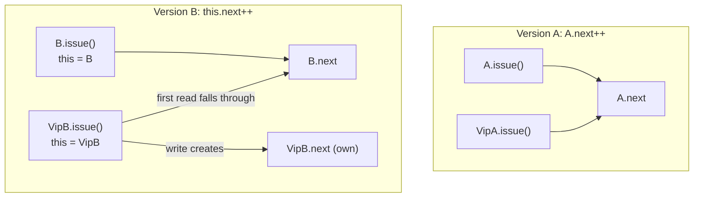

# 06 — Static `this` vs the class name, under inheritance

Demo: `npm run playground ex04__static-inherit`

This expands the Static members section of `06-classes/LESSON.md`. It
came up in ex04: your `TicketMachine.issue()` writes
`TicketMachine.next++`. What changes if it wrote `this.next++`?

With no subclass, nothing. With a subclass, a lot. Inside a static
method, `this` is whatever class you called it on. `VipB.issue()` runs
with `this = VipB`.

Statics are inherited through the prototype chain: `VipB`'s prototype
is `B`. So `this.next++` on `VipB` **reads** `B.next`, then **writes** a
new own property `VipB.next`. From then on the two counters split.

*Caption: naming the class always hits one shared counter. `this`
follows the caller, and the first write from a subclass forks the
counter.*

## What the run shows

| Line | Output | Why |
| --- | --- | --- |
| `A: A.issue(), VipA.issue(), A.issue()` | `100 101 102` | one counter, `A.next` |
| `B: B.issue(), VipB.issue(), B.issue(), VipB.issue()` | `100 101 101 102` | `VipB` read 101 from `B`, then got its own copy |
| `VipB has own next?` | `true` | the `++` wrote onto `VipB` |

Walk the B line: `B` gives 100 (B.next → 101). `VipB` reads 101, writes
`VipB.next = 102`. `B` gives 101 (B.next → 102). `VipB` gives its own
102.

## Which one to write

| You want | Write | Example |
| --- | --- | --- |
| one shared value for the whole family | `ClassName.x` | your `TicketMachine`, an id counter |
| each subclass to have its own copy | `this.x` (and expect the fork) | per-subclass registries |
| a method that is safe when detached | `ClassName.x` | see `ex04__static-this` |

## Gotchas

- The fork happens on the first **write**, not on declaration. Before
  `VipB` writes, `VipB.next` silently reads `B.next`.
- TypeScript gives no warning for either version. Both type-check clean.
- Related: [`ex04__static-this.md`](./ex04__static-this.md) shows the
  other cost of `this` in a static: pull the method off the class and
  `this` is gone.
