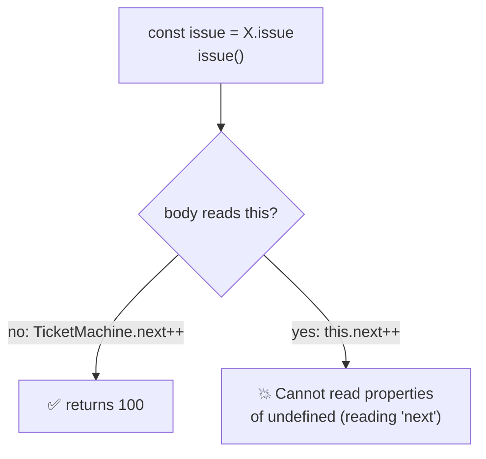

# 06 — Detaching a static method

Demo: `npm run playground ex04__static-this`

This expands the `this` pitfalls — detached methods section of
`06-classes/LESSON.md`, applied to statics. It imports your real
`TicketMachine` from ex04.

`const issue = TicketMachine.issue` grabs the function and drops the
object in front of the dot. So `this` is `undefined` when you call
`issue()`.

Whether that crashes depends on one thing: does the method body read
`this`?

*Caption: detaching always loses `this`. It only hurts when the method
needs it.*

## What the run shows

| Call | Body | Output |
| --- | --- | --- |
| detached `TicketMachine.issue()` | `TicketMachine.next++` | `100` |
| detached `ThisMachine.issue()` | `this.next++` | `💥 Cannot read properties of undefined (reading 'next')` |

## How this differs from `ex04__static-inherit`

| Demo | What changes `this` | Lesson |
| --- | --- | --- |
| [`ex04__static-inherit`](./ex04__static-inherit.md) | calling on a **subclass** | `this` follows the caller; counters fork |
| `ex04__static-this` (this one) | calling with **no object** | `this` is `undefined`; a `this`-based body crashes |

Both point the same way: for state shared by the whole class, name the
class.

## Gotchas

- The type-check is clean for both. TypeScript does not flag the
  crashing call, because `issue()` declares no `this` type.
- Add one and it will: `static issue(this: typeof ThisMachine)` makes
  the detached call fail with TS2684 ("The 'this' context of type
  'void' is not assignable to method's 'this' of type
  'typeof ThisMachine'"). See `lesson__this-binding` for the instance
  version.
- `TicketMachine.issue` still advanced the real counter. A detached call
  is a real call.
