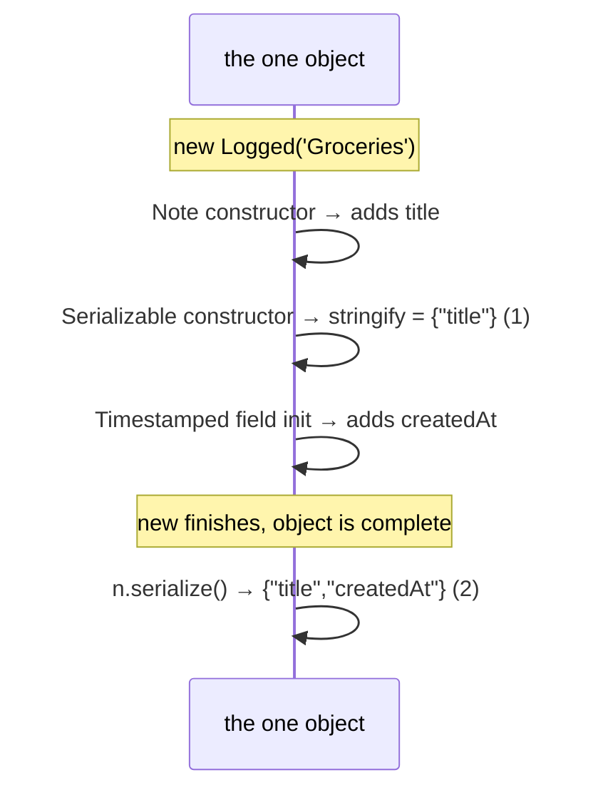

# 06 — Mixin construction order: who runs first?

Demo: `npm run playground ex07__puzzle`

This expands the Mixins section of `06-classes/LESSON.md` (and the
Inheritance — `extends`, `super`, and construction order section). It
is a cut-down copy of the mixin exercise's `Logged`
(`exercises/ex07.ts`): `Timestamped(Serializable(Note))`.

The puzzle: `Serializable`'s constructor stringifies `this`. Why is
`createdAt` missing there, but present after `new`?

`Timestamped(Serializable(Note))` builds a chain of three classes.
`Timestamped` is the outermost, so it is the one `Logged` extends. Each
constructor calls `super(...)` first, so the **innermost** class
finishes first.

*Caption: one object, built inside-out. When line (1) prints,
`Timestamped` has not run yet, so there is no `createdAt` to see.*

*Caption: read the call right to left to get construction order: Note,
then Serializable, then Timestamped.*

## What the run shows

| Line | Output |
| --- | --- |
| `1. inside Serializable constructor:` | `{"title":"Groceries"}` |
| `2. serialize() after new:` | `{"title":"Groceries","createdAt":"..."}` (current timestamp) |

## Order rules

| Step | Runs when |
| --- | --- |
| a class's field initializers (`createdAt = new Date()`) | right after its `super(...)` returns |
| a class's constructor body | after its own field initializers |
| a subclass's anything | only after the whole base chain is done |

## Gotchas

- Swap the order, `Serializable(Timestamped(Note))`, and line (1) would
  include `createdAt`. Mixin order is construction order.
- This is the same trap as "a base constructor calling an overridden
  method" in the lesson. Don't read subclass state from a base
  constructor.
- `serialize()` called **after** `new` always sees every layer. See
  [`ex07__serialize.md`](./ex07__serialize.md) for the real exercise class.
