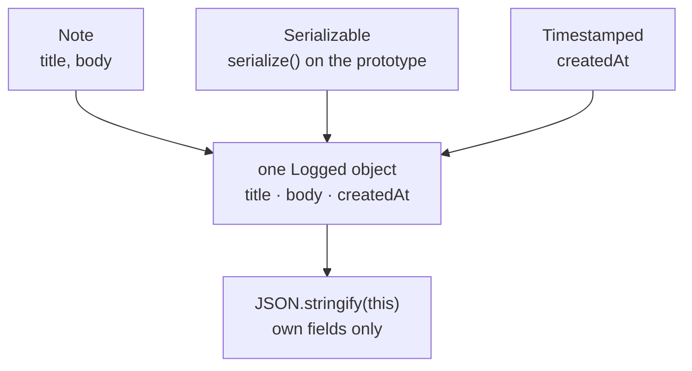

# 06 — `JSON.stringify(this)` sees every mixin layer

Demo: `npm run playground ex07__serialize`

This expands gotcha 3 of the Mixins section in `06-classes/LESSON.md`.
It imports your real `Logged` from the mixin exercise
(`exercises/ex07.ts`).

Mixins don't make separate objects. `Logged` is one class at the end of
a chain, and `new Logged(...)` makes one object. Every layer's fields
land on it as own properties.

So `serialize()`, written inside `Serializable`, prints fields it has
never heard of: `body` from `Note`, `createdAt` from `Timestamped`.

*Caption: data fields from every layer end up on one object.
Methods like `serialize` live on prototypes, so JSON skips them.*

## What the run shows

| Line | Output |
| --- | --- |
| `n.serialize()` | `{"title":"Groceries","body":"milk, eggs","createdAt":"..."}` |
| `Object.keys(n)` | `[ 'title', 'body', 'createdAt' ]` |

## Puzzle vs this demo

| Demo | When `serialize` runs | Sees `createdAt`? |
| --- | --- | --- |
| [`ex07__puzzle`](./ex07__puzzle.md) | inside a constructor, mid-build | ❌ not yet |
| `ex07__serialize` (this one) | after `new` finished | ✅ every layer |

## Gotchas

- `createdAt` is a `Date`, but JSON turns it into an ISO string. Parsing
  it back gives a string, not a `Date`.
- `createdAt` is `readonly`, not `private`. A `private` field would
  still serialize (TS `private` is erased), but callers couldn't read
  `n.createdAt` (TS2341). That was the modifier mix-up logged in your
  notes for ex07.
- Only `#private` fields are skipped by `JSON.stringify`.
