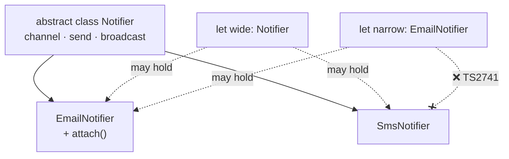
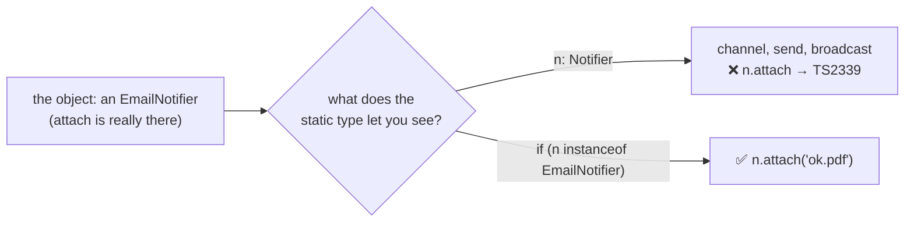

# 06 — Annotating with the abstract base (`: Notifier`)

Demo: `npm run playground lesson__abstract-type-as-supertype`

This expands the Abstract classes — templates with holes section of
`06-classes/LESSON.md` (the `// ✅ abstract type as supertype` line).

`const n: Notifier = new EmailNotifier()` is legal because every
`EmailNotifier` **is** a `Notifier`. You can't `new` an abstract class,
but you can use it as a type.

You don't *have* to annotate with the base. The annotation is a choice
about the future: what the variable may hold later, and what code may
lean on.

Wide type, wide door. `: Notifier` accepts any subclass. `: EmailNotifier`
accepts only emails.

Wide type, small view. Through `: Notifier` you see only the contract:
`channel`, `send`, `broadcast`. The email-only `attach()` is hidden until
you narrow back with `instanceof`.

*Caption: the annotation picks which boxes the variable may point at.
The base type admits every subclass; the concrete type admits one.*

*Caption: the base type hides members, it does not delete them. An
`instanceof` guard narrows back on purpose.*

## What the run shows

| Section | Line | Output |
| --- | --- | --- |
| 1. swap | `wide.channel` before / after `wide = new SmsNotifier()` | `email` / `sms` |
| 1. swap | `wide.broadcast(['a','b'], 'hi')` | `[sms] a: hi`, `[sms] b: hi` |
| 1. swap | `narrow = new SmsNotifier()` (TS2741, suppressed) | `narrow.channel` → `sms` |
| 2. contract | `notifyAll(new EmailNotifier(), …)` / `(new SmsNotifier(), …)` | `[email] ann: …` / `[sms] bob: …` |
| 3. hiding | `n.attach` exists at runtime? | `true` |
| 4. inference | `const inferred = new EmailNotifier()` | `inferred.channel` → `email`, `attach` allowed |
| 5. narrowing | `n instanceof EmailNotifier` / `n instanceof Notifier` | `true` / `true` |

The type-check is clean. Both intended errors sit under
`// @ts-expect-error`:

- TS2741: "Property 'attach' is missing in type 'SmsNotifier' but
  required in type 'EmailNotifier'." (assigning an SMS to `narrow`)
- TS2339: "Property 'attach' does not exist on type 'Notifier'." (calling
  `n.attach` through the base type)

## Which annotation?

| You want | Write | Why |
| --- | --- | --- |
| A variable that may switch subclass later | `let x: Notifier = …` | admits every subclass |
| A function that works with any notifier | `(n: Notifier)` | callers pass any subclass; you use only the contract |
| The subclass-only API, right now | `const x = new EmailNotifier()` | inference already gives the narrow type |
| The subclass API from a base-typed value | `if (x instanceof EmailNotifier)` | narrows on purpose, checked at runtime |

## Gotchas

- `@ts-expect-error` only silences the checker. Section 1 still runs the
  bad assignment, so `narrow` is typed `EmailNotifier` but holds an
  `SmsNotifier`. The type now lies.
- Hiding is compile-time only. Section 3's `n.attach(...)` runs fine,
  because the object really is an `EmailNotifier`.
- `instanceof Notifier` is `true` too. An abstract class is a real
  JavaScript class at runtime; only `new Notifier()` is blocked (TS2511).
- Parameters are where the base type pays off most. Locals are usually
  better left to inference.
- Related: [`lesson__shape-check.md`](./lesson__shape-check.md) (the
  same "contract, not origin" idea for interfaces) and
  [`lesson__extends-vs-implements.md`](./lesson__extends-vs-implements.md).
