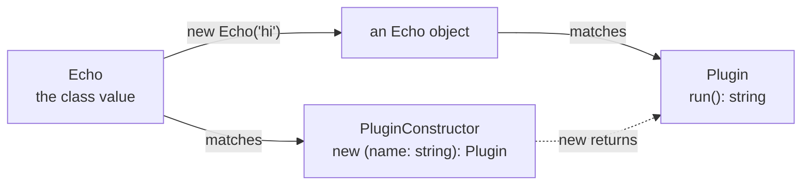
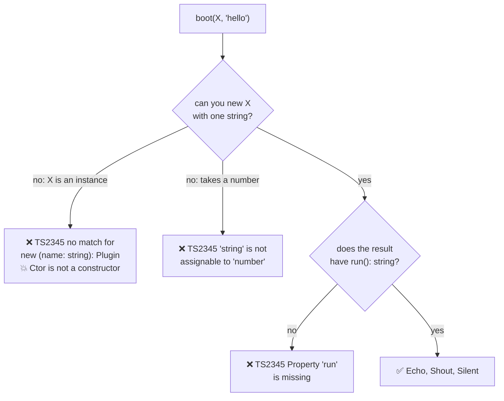

# 06 — Passing the class itself (`new (name: string): Plugin`)

Demo: `npm run playground lesson__construct-signatures-class-as-value`

This expands the end of the `implements` — a compile-time promise
section of `06-classes/LESSON.md`: "describe the constructor … and pass
the class as a value".

A class has two sides. `Plugin` describes the **instance** side: what
`new Echo('hi')` gives you. `implements` can only promise that side.

`PluginConstructor` describes the **static** side: `Echo` itself, a
thing you can `new`. Its one member is a construct signature:
`new (name: string): Plugin`.

So `boot(Ctor: PluginConstructor, …)` takes the **class**, not an
object. Inside, `new Ctor(name)` builds the instance.

*Caption: the construct signature describes the class; its return type
describes what the class builds. Both must match.*

*Caption: the checker tests the constructor first, then the instance it
returns. `implements` is never asked about.*

## What the run shows

| Call | Compiles? | Output |
| --- | --- | --- |
| `boot(Echo, 'hello')` | ✅ | `hello` |
| `boot(Shout, 'hello')` | ✅ | `HELLO!` |
| `boot(Silent, 'x')` (no `implements`) | ✅ | `""` |
| `boot(Counter, 'one')` (ctor takes `number`) | ❌ TS2345 | nothing printed (runs, result unused) |
| `boot(Mute, 'shh')` (no `run`) | ❌ TS2345 | nothing printed (runs, result unused) |
| `boot(new Echo('oops'), 'hello')` | ❌ TS2345 | `Ctor is not a constructor` (caught) |
| `registry.echo` / `registry.shout` | ✅ | `hi` / `HI!` |

The type-check is clean. The three ❌ calls sit under
`// @ts-expect-error`. Without it, each is TS2345 "Argument of type …
is not assignable to parameter of type 'PluginConstructor'", with these
second lines:

- `Counter`: "Types of parameters 'start' and 'name' are incompatible.
  Type 'string' is not assignable to type 'number'."
- `Mute`: "Property 'run' is missing in type 'Mute' but required in
  type 'Plugin'."
- instance: "Type 'Echo' provides no match for the signature 'new
  (name: string): Plugin'."

## Instance side vs static side

| | `interface Plugin` | `interface PluginConstructor` |
| --- | --- | --- |
| Describes | the object `new` returns | the class you call `new` on |
| Key member | `run(): string` | `new (name: string): Plugin` |
| A class can promise it with `implements` | ✅ | ❌ (only checked where the class is used) |
| You pass | `new Echo('hi')` | `Echo` |

## Gotchas

- No `implements Plugin` needed. `Silent` never wrote it and still
  passes. The check is structural, like
  [`lesson__shape-check.md`](./lesson__shape-check.md).
- Passing an instance is a type error **and** a real crash. The demo
  wraps it in try/catch so the rest runs.
- `export {}` matters. Without it the file is a global script, and
  `interface Plugin` merges with any global `Plugin`. Where the DOM lib
  is loaded (for example a bare `npx tsc file.ts`), that is
  `navigator.plugins`' `Plugin`, and every class suddenly "is missing
  description, filename, length…". The course config uses lib ES2022,
  so it doesn't bite here, but the module boundary keeps you safe.
- The registry loops over `Object.entries(registry)`. `registry[key]`
  would be `PluginConstructor | undefined` under
  `noUncheckedIndexedAccess` (TS2345 when passed to `boot`).
- `new (name: string): Plugin` in an interface and
  `new (name: string) => Plugin` as a type alias mean the same thing.
- Real uses (vitest `toThrow`, ORM repositories, factories):
  [`lesson__construct-signatures-real-world.md`](./lesson__construct-signatures-real-world.md).
  `typeof Echo` as the exact static type:
  [`lesson__typeof-class-static-vs-instance.md`](./lesson__typeof-class-static-vs-instance.md).
