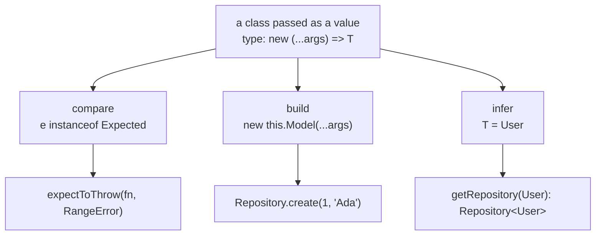
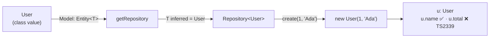

# 06 — Classes as values in real code

Demo: `npm run playground lesson__construct-signatures-real-world`

This expands the end of the `implements` — a compile-time promise
section of `06-classes/LESSON.md`: "pass the class as a value". It
answers "is that even a real use case?"

Yes. You have used it already. Each time, a library takes the **class**
and does one of two jobs with it.

Job 1: **compare.** `expect(fn).toThrow(RangeError)` keeps the class and
runs `e instanceof RangeError`. No `new` at all.

Job 2: **build.** `getRepository(User)` keeps the class and calls
`new User(...)` later, when it needs a row. The class is also the key
that tells TypeScript the result is `Repository<User>`.

*Caption: one class value gives a library three things: an `instanceof`
target, a factory, and the instance type `T`.*

*Caption: you hand over the class once. The framework does the `new`,
and the type flows through to every row.*

## What the run shows

| Section | Call | Output |
| --- | --- | --- |
| 1. compare | `expectToThrow(throws RangeError, RangeError)` | `✅ threw RangeError` |
| 1. compare | `expectToThrow(throws TypeError, RangeError)` | `❌ threw TypeError, expected RangeError` |
| 1. compare | `expectToThrow(() => {}, new RangeError('x'))` | `❌ did not throw` (and TS2345, suppressed) |
| 2. build | `users.create(1, 'Ada').name` | `Ada` |
| 2. build | `orders.create(7, 99.5).total` | `99.5` |
| 2. build | `u.total` (TS2339, suppressed) | `undefined` |
| 3. factory | `new shapes.square(2).area()` | `4.00` |
| 3. factory | every entry of `shapes` | `Square, area 4.00` / `Circle, area 12.57` |

The type-check is clean. Both intended errors sit under
`// @ts-expect-error`:

- TS2345: "Argument of type 'RangeError' is not assignable to parameter
  of type 'ErrorClass'. Type 'RangeError' provides no match for the
  signature 'new (...args: any[]): Error'."
- TS2339: "Property 'total' does not exist on type 'User'."

## The three patterns

| Pattern | The class is used for | Parameter type | Does `new`? |
| --- | --- | --- | --- |
| vitest `toThrow(RangeError)` | `instanceof` check | `new (...args: any[]) => Error` | ❌ |
| ORM / DI `getRepository(User)` | factory + type key | `new (...args: any[]) => T` | ✅ later |
| runtime factory `shapes[kind]` | pick a class by name | `new (n: number) => Shape` | ✅ now |

## Gotchas

- The instance case in section 1 compiles only because of
  `@ts-expect-error`. At runtime `fn` never throws, so the instance is
  never used. A real `instanceof` against an object crashes:
  "TypeError: Right-hand side of 'instanceof' is not callable".
- `(...args: any[])` buys flexibility and loses safety.
  `users.create('oops')` compiles, because `create` takes `any[]`. Real
  libraries tighten this with `ConstructorParameters<typeof User>`
  (module 08).
- `shapes[kind]` is `(new (n: number) => Shape) | undefined` under
  `noUncheckedIndexedAccess` (TS2532 if you `new` it directly). The demo
  guards it first.
- `kind` comes from `process.argv[2]`, but `npm run playground` doesn't
  forward extra args. Run `npx tsx playground/06-classes/lesson__construct-signatures-real-world.ts circle`
  to pick another shape.
- The basics (instance side vs static side, what gets rejected):
  [`lesson__construct-signatures-class-as-value.md`](./lesson__construct-signatures-class-as-value.md).
