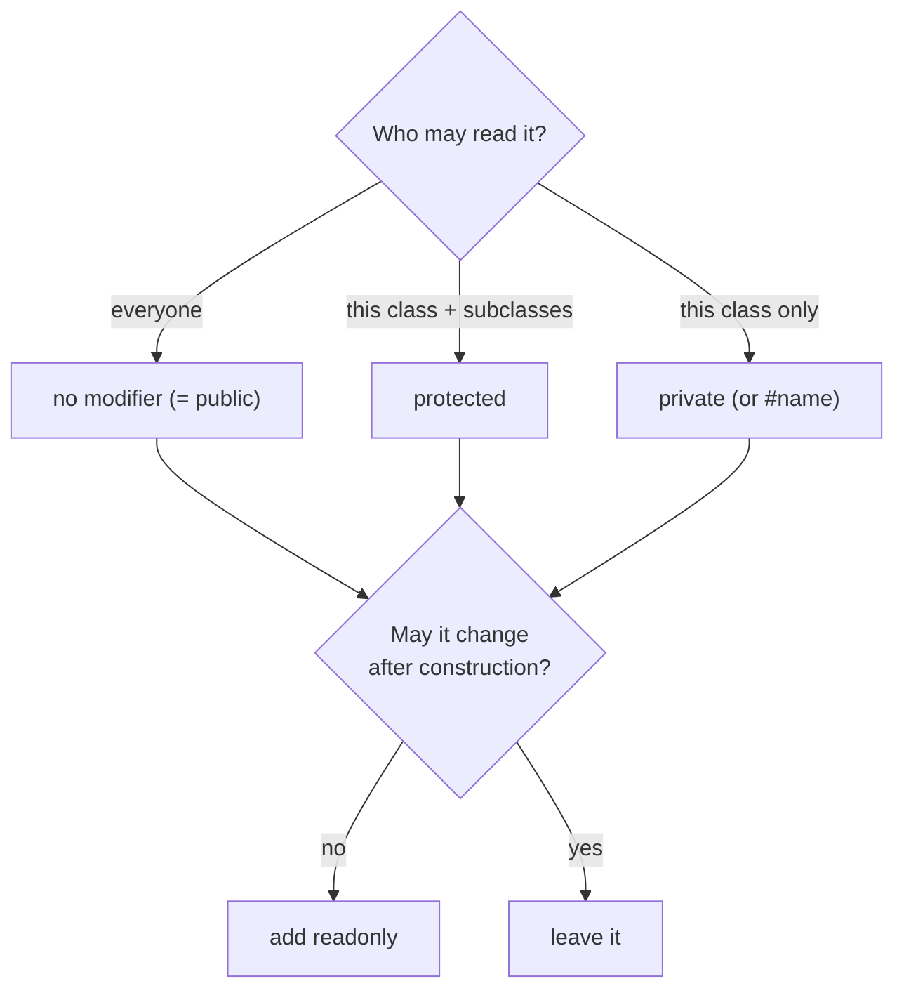

# 06 — No modifier means `public`

Demo: `npm run playground lesson__default-visibility`

This expands the Access modifiers — who may touch a member section of
`06-classes/LESSON.md`.

A member with no modifier is `public`. Writing `public` changes
nothing. The demo proves it: `Roster` and `RosterExplicit` are
assignable to each other both ways.

Then `Locked` adds `private` and `protected`, and outside reads stop
compiling.

*Caption: two separate questions. Visibility (who reads) and mutability
(may it change) are different axes, so you may need both.*

That diagram is the fix from your `NOTES.md` entry on ex01/ex07:
`protected` and `private` were picked when `readonly` was meant.

## What the run shows

| Line | Output |
| --- | --- |
| `Roster` | `Backend []` |
| `RosterExplicit` | `Backend []` |
| final check | `default visibility = public ✅ true true` |

The two `@ts-expect-error` lines confirm the errors. The type-check is
clean because each one is expected:

| Access from outside | Error |
| --- | --- |
| `l.team` (`private`) | TS2341 — private, only accessible within class `Locked` |
| `l.members` (`protected`) | TS2445 — protected, only within `Locked` and its subclasses |

## Gotchas

- Many style guides skip `public`. Seeing no modifier is normal.
- `private` and `protected` are erased. At runtime `l.team` is still
  there; TypeScript just won't compile the read.
- Default is `public` for constructors too. See the lesson's
  private-constructor section for when to change that.
