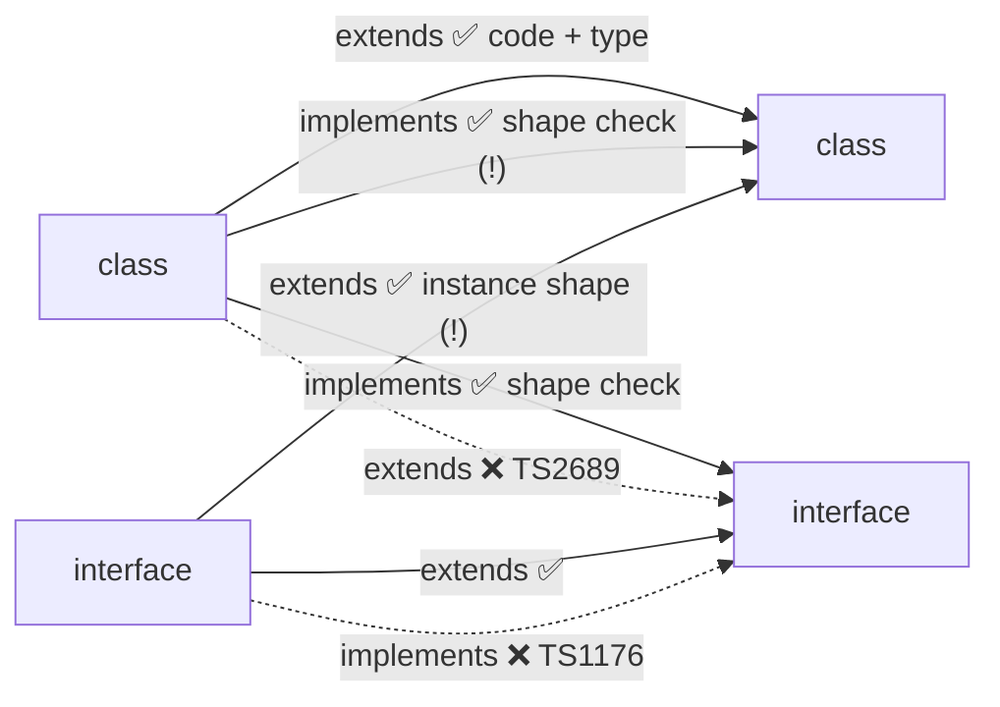

# 06 — Who may `extends` or `implements` whom

Demo: `npm run playground lesson__extends-vs-implements`

This expands the A small hierarchy diagram and the `implements` — a
compile-time promise section of `06-classes/LESSON.md`.

There are only two keywords, and two kinds of thing. That makes seven
combinations worth trying. Five compile. Two don't.

The rule behind all seven: `extends` between **classes** copies runtime
code, so the base must be a real value. Everything else is about
**shape** only, and a class can be read as a shape.

*Caption: only `class extends class` moves code. The other green arrows
just compare shapes. An interface never `implements` anything.*

## The grid

| # | Combination | Compiles? | Runtime output |
| --- | --- | --- | --- |
| 1 | class `extends` class | ✅ | `1` — `id` inherited |
| 2 | class `extends` interface | ❌ TS2689 "Cannot extend an interface 'Printable'. Did you mean 'implements'?" | 💥 `Printable is not defined` |
| 3 | class `implements` interface | ✅ | `c` |
| 4 | class `implements` class | ✅ | `2 \| instanceof Base? false` |
| 5 | interface `extends` interface | ✅ | (types only) |
| 6 | interface `extends` class | ✅ | `{ id: 3 }` — a plain object fits |
| 7 | interface `implements` anything | ❌ TS1176 "Interface declaration cannot have 'implements' clause." | (types only) |

## Gotchas

- Row 2 crashes at runtime, not just at compile time. Interfaces are
  erased, so `extends Printable` points at nothing. The demo wraps it in
  `try/catch` so the other rows still run.
- Row 4 copies **nothing**. `D` had to write its own `id = 2`, and it is
  not an instance of `Base`.
- Row 6 has a catch when the class has `private` members. See
  [`lesson__interface-extends-class.md`](./lesson__interface-extends-class.md).
- Related: [`lesson__small-hierarchy.md`](./lesson__small-hierarchy.md)
  shows each arrow kind *working*; [`lesson__shape-check.md`](./lesson__shape-check.md)
  shows what the shape check actually checks. This file is the only one
  with the full legal/illegal grid.
