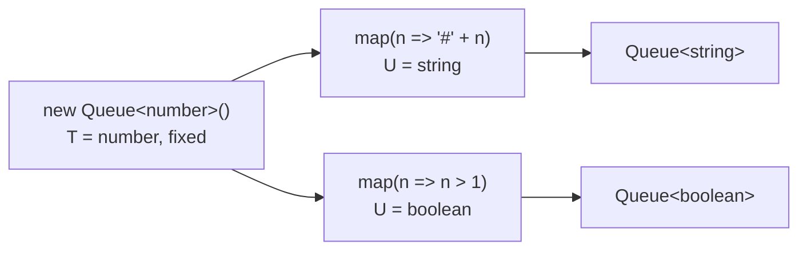

# 06 — A generic method on a generic class

Demo: `npm run playground lesson__generic-method-map`

This expands the Generic classes — the type parameter lives on the
instance section of `06-classes/LESSON.md` (the `map<U>` example).

A generic class gets **two** kinds of type parameter. `T` is on the
class: it is fixed once, when you `new` the queue. `U` is on the method:
it is picked fresh on every call.

That is how one `Queue<number>` can produce a `Queue<string>` and a
`Queue<boolean>` from the same method.

*Caption: `T` belongs to the instance and never changes. `U` is
inferred from each callback's return type.*

## What the run shows

| Line | Output | Type |
| --- | --- | --- |
| `nums` | `[ 1, 2, 3 ]` | `Queue<number>` (untouched) |
| `labels` | `[ '#1', '#2', '#3' ]` | `Queue<string>` |
| `flags` | `[ false, true, true ]` | `Queue<boolean>` |

## Class parameter vs method parameter

| | `T` (on `class Queue<T>`) | `U` (on `map<U>`) |
| --- | --- | --- |
| Declared | after the class name | after the method name |
| Chosen | at `new Queue<number>()` | at each `map(...)` call |
| Inferred from | constructor args (or written by hand) | the callback's return |
| Can a `static` use it? | ❌ TS2302 | ✅ a static method may declare its own |

## Gotchas

- The callback's parameter is **not** free. It must accept a `T`. The
  commented line `nums.map((s: string) => s.length)` fails with TS2345:
  "Argument of type '(s: string) => number' is not assignable to
  parameter of type '(item: number) => number'."
- `map` returns a new queue. The original stays `[1, 2, 3]`.
- `new Queue()` with no type argument gives `Queue<unknown>`. Nothing to
  infer from, so write `<number>`.
