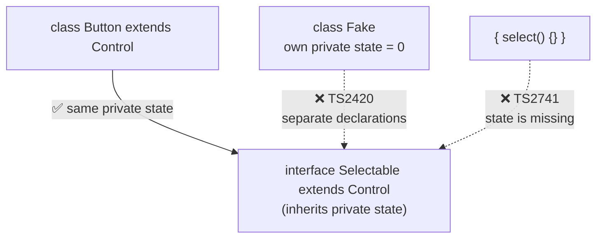

# 06 — An interface that extends a class with `private`

Demo: `npm run playground lesson__interface-extends-class`

This expands the `private` makes a class nominal section of
`06-classes/LESSON.md`.

An interface can extend a class. It takes the class's instance shape.
Usually that shape is just public members, so anything shaped right fits.

But `Control` has a `private state`. A private member carries its
**origin** with it. So `Selectable` now means "a real descendant of
`Control`, plus `select()`".

*Caption: only `Control`'s own `private state` counts. A look-alike
declaration in another class is a different member.*

## What the run shows

| Check | Result |
| --- | --- |
| type-check | 2 errors, both intended (below) |
| `Button.select()` | `clicked` |
| `is a Control?` (inside `activate`) | `true` |
| `Fake instanceof Control` | `false` |

| Line | Error |
| --- | --- |
| `class Fake implements Selectable` | TS2420 — incorrectly implements; "Types have separate declarations of a private property 'state'." |
| `const obj: Selectable = { select() {} }` | TS2741 — Property 'state' is missing |

## Structural vs nominal here

| Interface extends a class with… | Who satisfies it |
| --- | --- |
| only public members | anything with that shape (row 6 of `lesson__extends-vs-implements`) |
| a `private` / `protected` member | only that class and its subclasses |

## Gotchas

- The object literal can never pass. You can't write a private member in
  a literal.
- Use it when code taking a `Selectable` must rely on it **being** a
  `Control` (e.g. calling `Control`'s protected helpers from a subclass).
- The errors are compile-time only. `Fake` still runs; the runtime
  `instanceof` line shows what TS was protecting you from.
