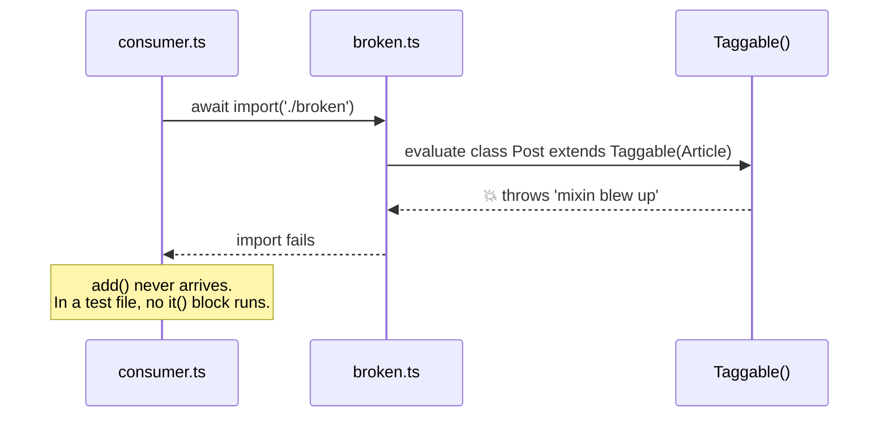

# 06 — When does a mixin run?

Demo (two files in `lesson__mixin-eval/`):

- `npm run playground playground/06-classes/lesson__mixin-eval/order.ts`
- `npm run playground playground/06-classes/lesson__mixin-eval/consumer.ts`

This expands gotcha 2, "Evaluation order", in the Mixins section of
`06-classes/LESSON.md`.

`class Post extends Taggable(Article) {}` looks like a declaration. It
is also a **function call**. `Taggable` runs the moment that line is
evaluated, at module load, once. Not on `new`.

So if a mixin throws, the whole module fails to load. Every importer
fails too, even one that only wanted an innocent helper.

| File | Role |
| --- | --- |
| `order.ts` | prints numbered steps to show when `Taggable` runs |
| `broken.ts` | a module whose mixin throws; **not meant to be run directly** (it just crashes) |
| `consumer.ts` | imports `broken.ts` only for `add`, and catches the failure |

*Caption: a mixin call sits in the module's top level. If it throws,
nothing exported from that file is usable.*

## What the runs show

`order.ts`:

| Output | Meaning |
| --- | --- |
| `1. before the class statement` | module is loading |
| `2. Taggable runs — building the class` | the `class` line called the mixin |
| `3. after the class statement — no Post created yet` | the class exists, no instance |
| `4. now we made an instance (Taggable did NOT run again)` | `new` does not re-run the mixin |

`consumer.ts`:

| Output |
| --- |
| ``--- consumer: importing broken.ts, only wants `add` `` |
| `import failed: mixin blew up` |

## Mixin call vs constructor

| | Mixin function (`Taggable(...)`) | Mixin class constructor |
| --- | --- | --- |
| Runs | once, when the `class` line is evaluated | on every `new` |
| If it throws | module import fails | that one `new` fails |

## Gotchas

- In a test run this shows up as "the whole file errored", not as
  failing tests. Look at the import, not the assertions.
- `consumer.ts` uses a dynamic `await import(...)` only so the failure
  can be caught. A normal top-level `import` would crash before any of
  its code ran.
- Construction order inside `new` is a different question. See
  [`ex07__puzzle.md`](./ex07__puzzle.md).
