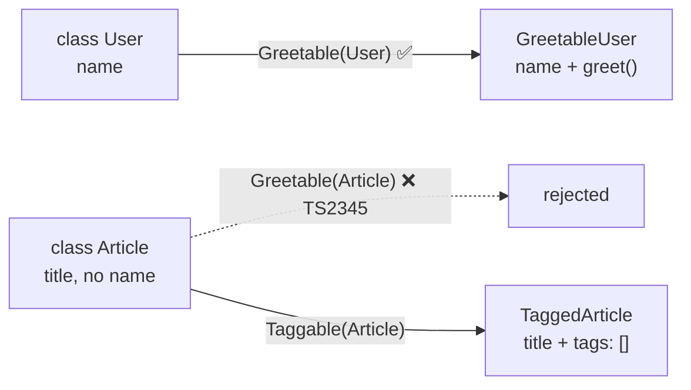

# 06 — A constrained mixin, and why `&` isn't enough

Demo: `npm run playground lesson__mixin-greetable`

This expands the Mixins section of `06-classes/LESSON.md` (the
`Greetable` and `TaggedArticle` examples).

Two ideas. First, a mixin can **demand** something from its base:
`Greetable` needs a `name`, so its constraint is
`Constructor<{ name: string }>`. Second, a mixin **builds** members at
runtime. A type intersection only describes them.

*Caption: the constraint is checked when you call the mixin. A base
without `name` never gets in.*

## What the run shows

| Line | Output |
| --- | --- |
| `ada.greet()`, `still a User?` | `Hello, Ada \| still a User? true` |
| `mixin   :` | `Article { title: 'x', tags: [] }` |
| `plain   :` | `Article { title: 'x' }` |

## Mixin vs intersection

| | `Taggable(Article)` | `Article & { tags: string[] }` |
| --- | --- | --- |
| Exists at runtime | ✅ a real class | ❌ type only |
| Creates `tags` | ✅ field initializer runs on `new` | ❌ nothing creates it |
| `const t: X = new Article('x')` | — | ❌ TS2322, `tags` is missing |

## Gotchas

- The mixin returns a **new class**. Store it (`const GreetableUser =
  Greetable(User)`) or extend it, then `new` it.
- The result is still a `User`: `instanceof User` is `true`, because
  the new class extends `User`.
- `Greetable(Article)` fails with TS2345 ("Argument of type 'typeof
  Article' is not assignable to parameter of type 'Constructor<{ name:
  string; }>'"). The check is on the constructor, not the instance.
- For *when* the mixin function runs, see
  [`lesson__mixin-eval.md`](./lesson__mixin-eval.md).
