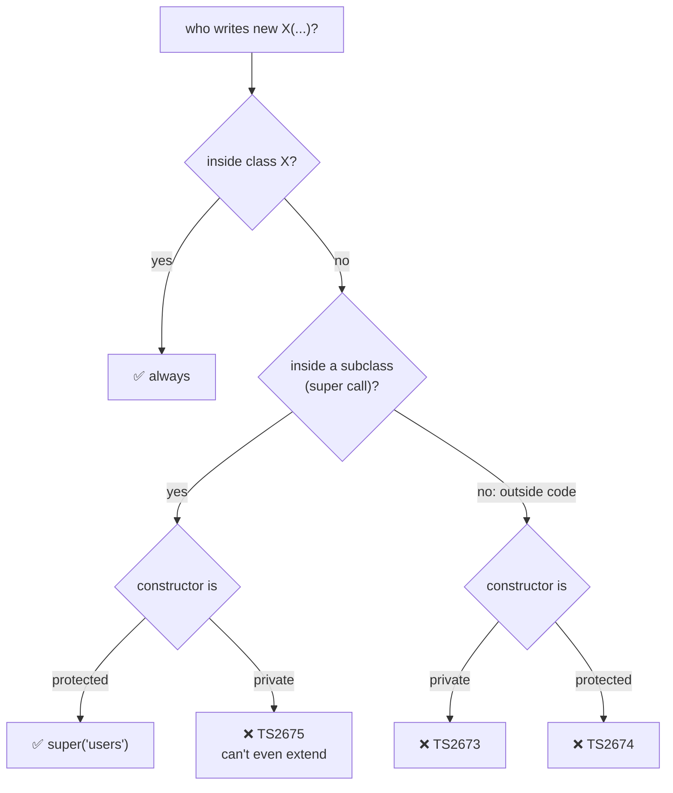
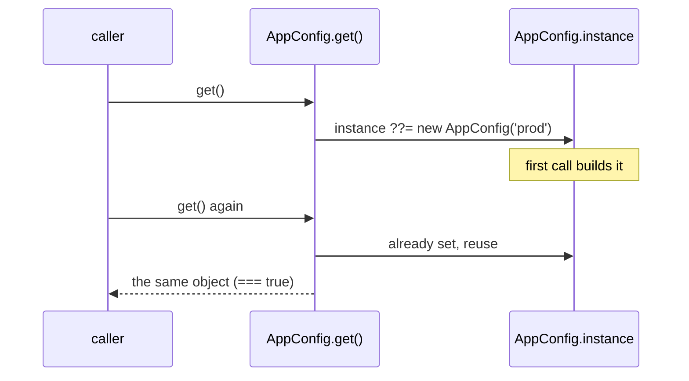

# 06 — `private` vs `protected` constructors

Demo: `npm run playground lesson__private-constructors-singletons-factories`

This expands the `private` and `protected` constructors — singletons and
factories section of `06-classes/LESSON.md`.

A constructor can carry a modifier, like any member. It controls one
thing: **who may write `new`**.

`private constructor`: only code inside the class. Everyone else must go
through a static method you wrote, like `AppConfig.get()`. That method
can return the same object every time. That's a singleton.

`protected constructor`: the class and its subclasses. Outsiders can't
`new Repository(...)`, but `UserRepository` may call `super('users')`.
The base becomes a factory for subclasses only.

*Caption: `private` closes the door to everyone but the class.
`protected` leaves it open for subclasses only.*

*Caption: the singleton is just a static field plus `??=`. The private
constructor makes `get()` the only way in.*

## What the run shows

| Line | Compiles? | Output |
| --- | --- | --- |
| `AppConfig.get().env` | ✅ | `prod` |
| `AppConfig.get() === AppConfig.get()` | ✅ | `true` |
| `new AppConfig('dev')` | ❌ TS2673 | runs anyway: `sneaky.env -> dev` |
| `sneaky === AppConfig.get()` | ✅ | `false` (a second "singleton") |
| `new UserRepository().table` | ✅ | `users` |
| `new Repository('x')` | ❌ TS2674 | runs anyway: `bare.table -> x` |
| `new UserRepository2('abc')` | ✅ | `UserRepository2 { table: 'abc' }` |

The two errors are intended and **not** suppressed, so the type-check
prints them, then the runner runs the file anyway:

- TS2673: "Constructor of class 'AppConfig' is private and only
  accessible within the class declaration."
- TS2674: "Constructor of class 'Repository' is protected and only
  accessible within the class declaration."

## `public` vs `protected` vs `private` constructor

| Constructor | `new X()` outside | `class Y extends X` + `super()` | Typical use |
| --- | --- | --- | --- |
| `public` (default) | ✅ | ✅ | ordinary classes |
| `protected` | ❌ TS2674 | ✅ | abstract-ish base, subclasses only |
| `private` | ❌ TS2673 | ❌ TS2675 | singleton, or named factories like `Temp.fromCelsius()` |

## Gotchas

- It's compile-time only. The emitted JavaScript has no private
  constructors, so `new AppConfig('dev')` really runs and breaks the
  singleton. Need a runtime guard? Throw inside the constructor when
  `AppConfig.instance` is already set.
- A subclass can reopen the door. `UserRepository2` declares a plain
  (public) constructor, so `new UserRepository2('abc')` works from
  anywhere, with any table name.
- A private or protected constructor won't fit a public construct
  signature. Passing `AppConfig` to `(C: new (env: string) => AppConfig)`
  is TS2345: "Cannot assign a 'private' constructor type to a 'public'
  constructor type." See
  [`lesson__construct-signatures-class-as-value.md`](./lesson__construct-signatures-class-as-value.md).
- `protected constructor` vs `abstract class`: both block outside `new`.
  Only `abstract` also lets you leave members unimplemented. See
  [`lesson__abstract-type-as-supertype.md`](./lesson__abstract-type-as-supertype.md).
- For how `AppConfig.instance` behaves as static state, see
  [`ex04__static-inherit.md`](./ex04__static-inherit.md).
