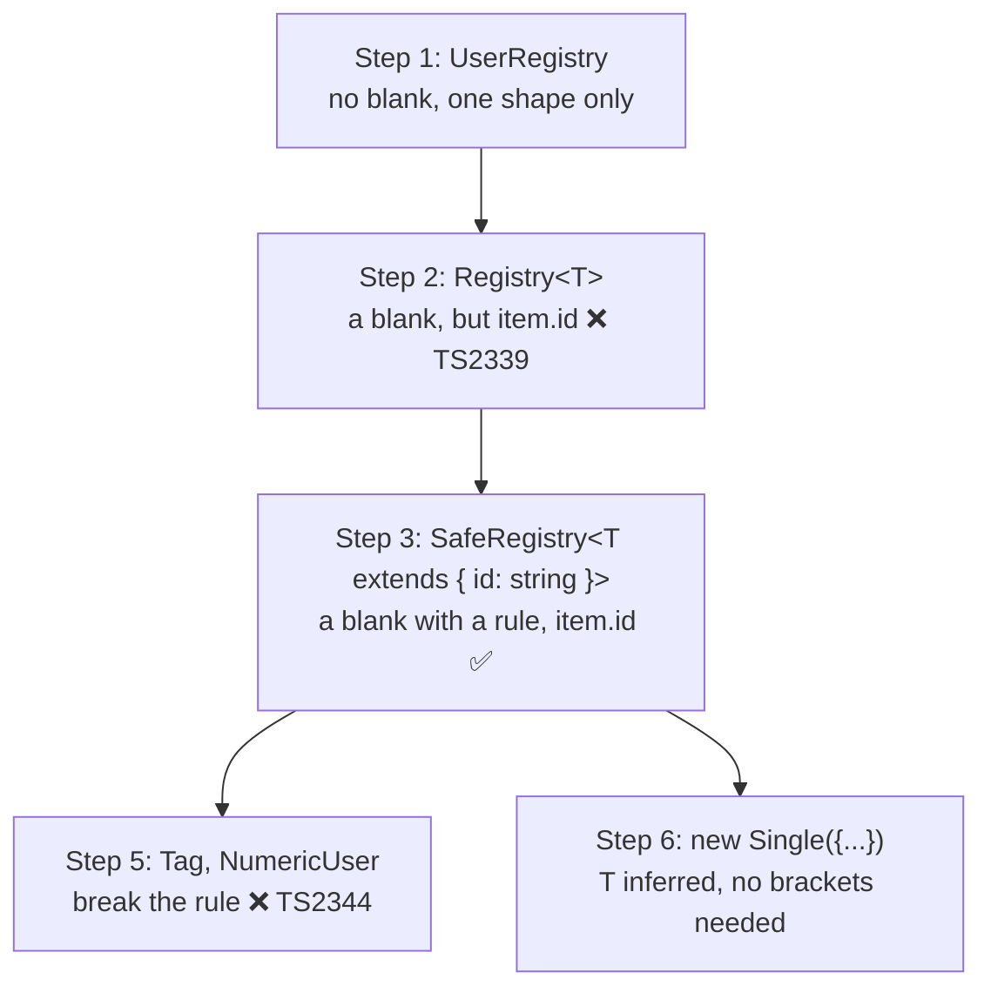

# 06 — How to read `class Registry<T extends { id: string }>`

Demo: `npm run playground lesson__reading-angle-brackets`

This expands the Generic classes — the type parameter lives on the
instance section of `06-classes/LESSON.md`. It is a reading guide, so
you can follow generic classes before module 07.

Read `<T>` like a function parameter, but for a type. The class is a
blueprint with a blank. `new Registry<...>` fills the blank. You already
do this with `Array<string>` and `Map<string, number>`.

`extends` inside the angle brackets is **not** inheritance. It is a rule
on the blank: "whatever fills T must at least have `id: string`".

*Caption: each step adds one thing. The constraint is what lets the
class body use `item.id`.*

## What the run shows

| Line | Output | T was |
| --- | --- | --- |
| `users.get(u1)?.name` | `Ada` | `{ id: string; name: string }` |
| `products.get(p1)?.price` | `9` | `{ id: string; price: number }` |
| `userRegistry.get(u2)?.name` | `Grace` | `UserT` |
| `productRegistry.get(p2)?.price` | `42` | `Product` |
| `one.item.name` | `inferred` | inferred from the constructor argument |

## Fits the blank or not

| Type passed as T | Has `id: string`? | Result |
| --- | --- | --- |
| `{ id: string; name: string }` | ✅ (extra `name` is fine) | ✅ |
| `UserT`, `Product` | ✅ by shape, never mention the constraint | ✅ |
| `Tag` (`label` only) | ❌ missing | TS2344, "Property 'id' is missing" |
| `NumericUser` (`id: number`) | ❌ wrong type | TS2344, "Types of property 'id' are incompatible" |

## Gotchas

- Without the constraint (Step 2), `item.id` is TS2339. TypeScript
  knows nothing about T. It could be a `number`.
- The constraint checks **shape**, not name. Structural typing from
  module 03 applies to the blank too.
- Each `new` fills the blank separately. `users` and `products` are
  different types built from one class.
- Related: [`lesson__party-of-t.md`](./lesson__party-of-t.md) uses an
  interface as the constraint instead of an inline shape.
