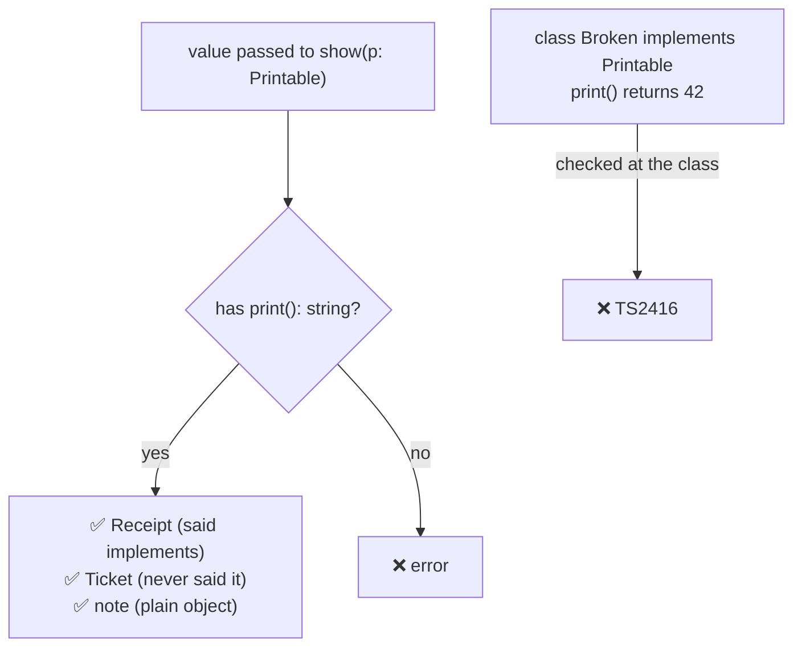

# 06 — What the "shape check" checks

Demo: `npm run playground lesson__shape-check`

This expands the `implements` — a compile-time promise and Classes are
structural too sections of `06-classes/LESSON.md`.

When a function wants a `Printable`, TypeScript asks one question: does
this value have `print(): string`? It does not ask where the value came
from, or whether its class said `implements`.

`implements` is for the class author. It makes the compiler check the
class **at its declaration**, so a wrong shape fails there instead of at
some far-away call.

*Caption: the call site checks members only. `implements` adds an early
check at the class, nothing else.*

## What the run shows

| Call | Output | Why it passed |
| --- | --- | --- |
| `show(new Receipt())` | `receipt` | has `print`, and promised it |
| `show(new Ticket())` | `ticket` | has `print`, never promised |
| `show(note)` | `note` | has `print`, not even a class |

The type-check shows one intended error, on `Broken`: TS2416, "Property
'print' in type 'Broken' is not assignable to the same property in base
type 'Printable'… Type 'number' is not assignable to type 'string'."

## With and without `implements`

| | `class Receipt implements Printable` | `class Ticket` (no clause) |
| --- | --- | --- |
| Accepted by `show()` | ✅ | ✅ |
| Wrong shape caught | at the class line | only where it's used as `Printable` |
| Anything inherited | ❌ nothing | ❌ nothing |

## Gotchas

- `implements` copies no code and no types. You still write `print()`
  and its parameter types yourself.
- A fresh object literal with an **extra** key, written straight into a
  `Printable` slot, is an excess-property error (TS2353). Through a
  variable it passes. That is module 03 freshness, not a class rule.
- Related: [`lesson__extends-vs-implements.md`](./lesson__extends-vs-implements.md)
  (the full keyword grid) and [`lesson__small-hierarchy.md`](./lesson__small-hierarchy.md)
  (each arrow kind). This file is the only one about *what* gets compared.
