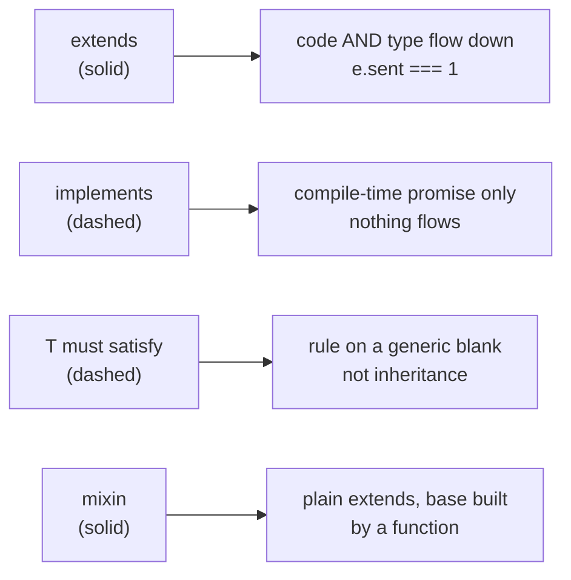

# 06 — The four arrows in "A small hierarchy"

Demo: `npm run playground lesson__small-hierarchy`

This expands the A small hierarchy diagram at the top of
`06-classes/LESSON.md`.

The lesson diagram uses four kinds of arrow. The demo builds each one
alone, so you can see what flows along it.

*Caption: only the solid arrows move runtime code. The dashed ones are
checks the compiler does and then forgets.*

## What the run shows

| Section | Output | Proves |
| --- | --- | --- |
| 1. extends | `email: hi`, then `inherited field via extends: 1` | `sent` and `log()` came from `Notifier` |
| 2. implements | `typeof Notifier: function`, `typeof EmailNotifier: function` | a class is a runtime value |
| 3. T must satisfy | (no output) | `Registry` accepts a shape with `id` |
| 4. mixin | `Post has both: untitled []` | `title` from `Article`, `tags` from the mixin |

## The four arrows

| Arrow | Moves runtime code? | Exists after compile? | Error if broken |
| --- | --- | --- | --- |
| `extends` | ✅ | ✅ | — |
| `implements` | ❌ | ❌ (interface erased) | TS2420, class incorrectly implements |
| `T extends {...}` | ❌ | ❌ | TS2344, does not satisfy the constraint |
| mixin `extends Fn(Base)` | ✅ | ✅ | depends on the mixin |

## Gotchas

- `typeof Printable` fails with TS2693: "'Printable' only refers to a
  type, but is being used as a value here." An interface has no runtime
  form. That line is commented out in the demo.
- `abstract send()` is a promise, like an interface member. `log()` and
  `sent` are real code. One abstract class can carry both.
- Related: [`lesson__extends-vs-implements.md`](./lesson__extends-vs-implements.md)
  tries the illegal combinations; this file only shows the legal ones,
  one per arrow. For the story of *why* you'd pick each, see
  [`lesson__why-interface-and-party.md`](./lesson__why-interface-and-party.md).
