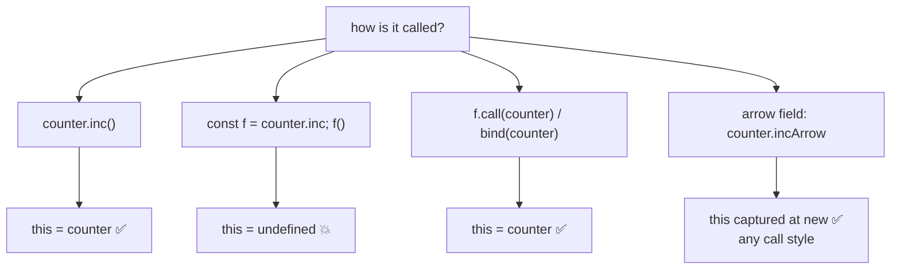

# 06 — Who sets `this`? The call site

Demo: `npm run playground lesson__this-binding`

This expands the `this` pitfalls — detached methods section of
`06-classes/LESSON.md`.

A normal method's `this` is not fixed. It is whatever sits before the
dot **at the moment of the call**. `counter.inc()` has `counter` there.
`detached()` has nothing, so `this` is `undefined`.

An arrow-function field is different. It captures `this` once, when the
object is built, and keeps it forever.

*Caption: for a prototype method, the call decides `this`. For an
arrow field, construction decided it.*

## What the run shows

| # | Call | Output |
| --- | --- | --- |
| 1 | `counter.inc()` | `1` |
| 2 | `detached()` | `💥 Cannot read properties of undefined (reading 'count')` |
| 3 | `unchecked()` (no `this:`) | `💥` same message |
| 4a | `counter.inc.bind(counter)()` | `2` |
| 4b | `detached.call(counter)` | `3` |
| 4c | arrow field `safe()` | `4` |
| 5a | `[1, 2].forEach(counter.incArrow)` | `6` |
| 5b | `[1, 2].forEach(counter.inc)` | `💥` same message |
| 6 | shared method? / shared arrow? | `true` / `false` |

## What TypeScript catches

| Case | `this: Counter` declared? | Compile error? | Runtime |
| --- | --- | --- | --- |
| 2. `detached()` | ✅ | TS2684 (expected by the directive) | 💥 |
| 3. `unchecked()` | ❌ | none | 💥 |
| 5b. `forEach(counter.inc)` | ✅ | **none** | 💥 |

## Gotchas

- Case 5b is the surprise. `forEach`'s callback type declares no `this`,
  so TS doesn't compare it. The `this:` check catches direct calls, not
  every hand-off.
- Arrow fields cost one function per instance (`shared arrow? false`)
  and can't be reached with `super.incArrow()`. Use them for callbacks
  you hand out, not for every method.
- `this: Counter` is a fake parameter. It is erased; callers never pass
  it.
- The static version of this bug is in
  [`ex04__static-this.md`](./ex04__static-this.md).
