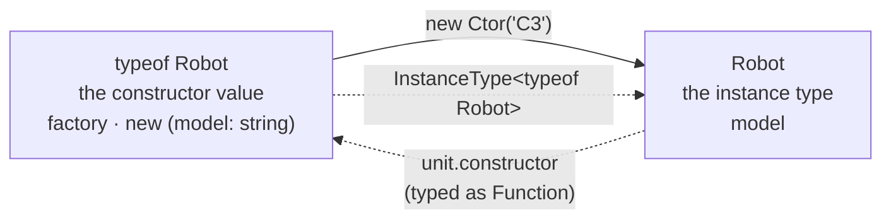
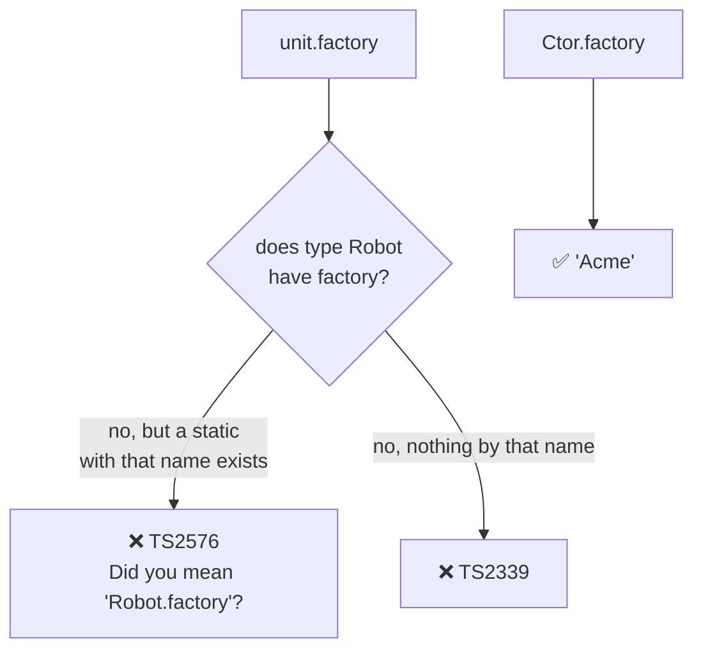

# 06 — `Robot` vs `typeof Robot`

Demo: `npm run playground lesson__typeof-class-static-vs-instance`

This expands the `typeof Class` — the static side vs the instance side
section of `06-classes/LESSON.md`.

One `class Robot` declaration creates two things with the same name: a
**value** (the constructor function) and a **type** (its instances).

`Robot` in a type position means "an instance". It has `model`.

`typeof Robot` means "the constructor itself". It has `factory` and a
`new` signature.

`InstanceType<typeof Robot>` walks back from the constructor to the
instance type. It gives you `Robot` again.

*Caption: statics live on the left, instance members on the right. You
can walk left-to-right with `new` or `InstanceType`; walking back loses
the type.*

*Caption: reaching for a static through an instance gets its own error
code, TS2576, which even names the fix.*

## What the run shows

| Line | Output | What it proves |
| --- | --- | --- |
| `Ctor === Robot` | `true` | `typeof Robot` is just the class value |
| `typeof Ctor` / `typeof unit` | `function` / `object` | the two sides are different things at runtime too |
| `Ctor.factory` | `Acme` | statics live on the constructor |
| `unit.model` | `R2` | instance members live on the object |
| `fromCtor.model` | `C3` | `new` on the static side gives the instance side |
| `fromCtor instanceof Robot` | `true` | same class, just held in another variable |
| `unit.constructor === Robot` | `true` | the runtime way back to the class |
| `unit.factory` | `undefined` | ❌ TS2576, runs anyway |

The one intended error is **not** suppressed, so the type-check prints
it, then the runner runs the file anyway: TS2576, "Property 'factory'
does not exist on type 'Robot'. Did you mean to access the static
member 'Robot.factory' instead?"

## The two types side by side

| | `Robot` | `typeof Robot` |
| --- | --- | --- |
| Names | an instance | the constructor (the class value) |
| Has | `model` | `factory`, `prototype`, `new (model: string)` |
| Example value | `new Robot('R2')` | `Robot` |
| `const x: Robot = Robot` | ❌ TS2741 (`model` missing) | ✅ |
| `new x('R2')` on a value of this type | ❌ TS2351 not constructable | ✅ |
| Get the other one | `typeof` needs a value, not a type | `InstanceType<typeof Robot>` |

## Gotchas

- `typeof` here is the **type-level** `typeof`: it takes a value
  (`Robot`, the class) and returns its type. The runtime `typeof Ctor`
  just prints `"function"`.
- `unit.constructor` is typed as `Function`, not `typeof Robot`. So
  `unit.constructor.factory` is TS2339 ("Property 'factory' does not
  exist on type 'Function'"), even though it works at runtime.
- Any object with a `model: string` is a `Robot` to the checker. Robot
  has no private members, so the instance type is purely structural.
- `typeof Robot` is the exact static type. When any class with the
  right constructor should fit, use a construct signature instead:
  [`lesson__construct-signatures-class-as-value.md`](./lesson__construct-signatures-class-as-value.md).
- Statics under inheritance and detached static methods:
  [`ex04__static-inherit.md`](./ex04__static-inherit.md) and
  [`ex04__static-this.md`](./ex04__static-this.md).
- `06-classes/LESSON.md` labels the `unit.factory` line TS2339; the
  compiler actually reports TS2576. The lesson's verifier only checks
  that the line errors.
