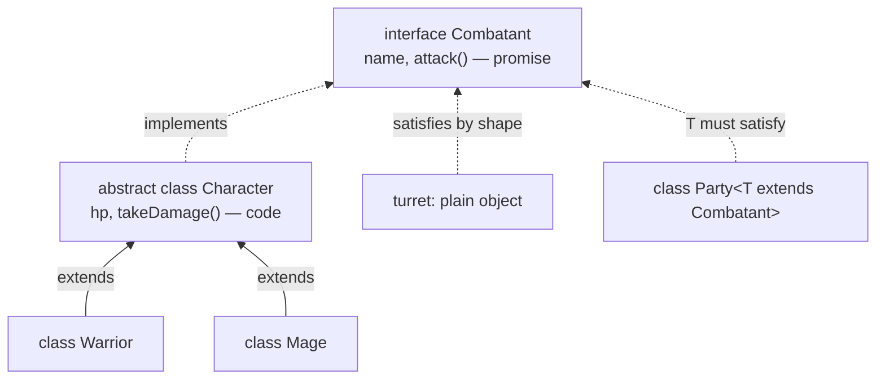

# 06 — Why both an interface and an abstract class?

Demo: `npm run playground lesson__why-interface-and-party`

This expands the A small hierarchy diagram in `06-classes/LESSON.md`.
It answers: why does the hierarchy need `Combatant` **and** `Character`?

They do different jobs. `Combatant` is the minimum promise: "can fight".
`Character` is shared code: `hp` and `takeDamage`. A turret can fight
but has no hit points. It fits the promise and not the code.

*Caption: `Party` asks for the small promise, so the turret gets in.
Asking for `Character` would shut it out.*

## What the run shows

| Line | Output | Why |
| --- | --- | --- |
| `raid damage:` | `22` | Warrior 10 + Mage 7 + turret 5 |
| `ok` | `ok` | `strict.add(turret)` is a compile error, expected by `@ts-expect-error` |

## Each tool's job

| Tool | Job here | Without it |
| --- | --- | --- |
| `interface Combatant` | the smallest "can fight" promise | `Party` would have to demand `Character`, rejecting the turret |
| `abstract class Character` | shared `hp` + `takeDamage` | `Warrior` and `Mage` copy that code |
| `extends` | `Warrior`/`Mage` reuse it and fill in `attack()` | — |
| `Party<T extends Combatant>` | a container that only needs members to fight | — |

## Gotchas

- `StrictParty<T extends Character>` rejects the turret: it has no `hp`
  or `takeDamage`. Demand the smallest type that does the job.
- `Party` itself is not a `Combatant`. It only constrains its members.
  See [`lesson__party-of-t.md`](./lesson__party-of-t.md).
- `add()` returns `this`, so calls chain. The lesson's "`this` as a
  return type" section covers why that survives subclassing.
