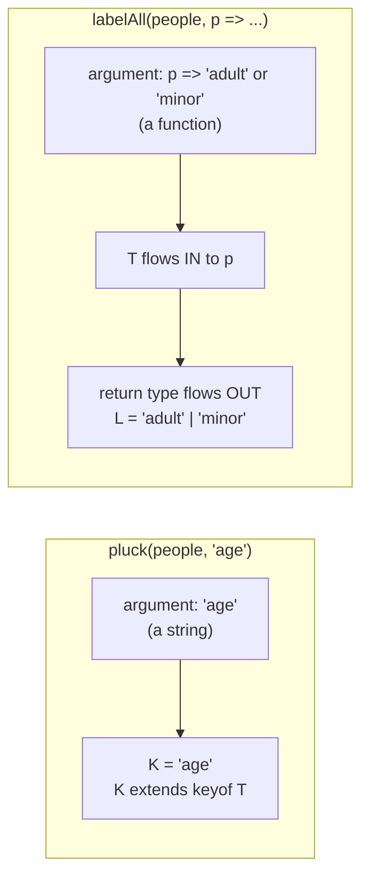
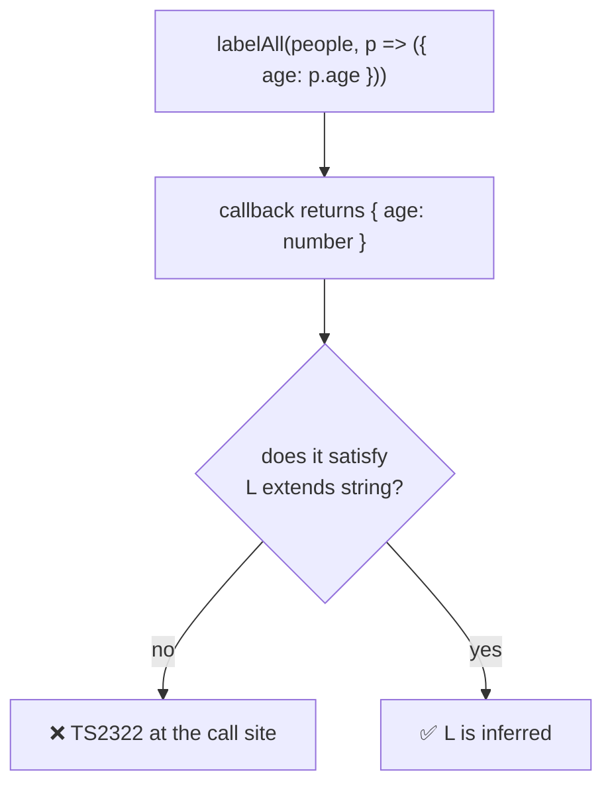

# 07 — A key NAME vs a key FUNCTION

Demo: `npm run playground cp__callback-key`

Prompted by checkpoint 7b's `groupBy`. In `groupBy(people, p => ...)`,
the second argument is not a property name. It is a **function**.

`pluck` (ex06) and `indexBy` take a key *name*, like `'age'`. So their
`K` is `keyof T`. `groupBy` takes a function that *computes* a key.
So its `K` is "whatever that function returns".

*Caption: a key name is a value of type `keyof T`. A key function is
typed `(item: T) => L`, and `L` is read from what it returns.*

*Caption: the constraint sits on the RETURN type parameter. That is how a
bad key gets rejected.*

## Name vs function

| | `pluck` / `indexBy` | `labelAll` / `groupBy` |
| --- | --- | --- |
| Caller passes | `'age'` | `p => p.age >= 18 ? 'adult' : 'minor'` |
| Parameter type | `key: K` | `fn: (item: T) => K` |
| `K` constrained by | `keyof T` | what a valid key may be |
| Body gets the key by | `item[key]` | `fn(item)` |

## Gotchas

- `K extends keyof T` on a callback is a category error: `keyof T` is a
  set of property names, not a function type.
- `items: T` with `T` being an array makes `keyof T` the *array's* keys
  (`length`, `map`, ...). Take `readonly T[]` so `T` is one item.
- The constraint goes on the type parameter (`<T, L extends ...>`), not on
  the callback's parameter.
