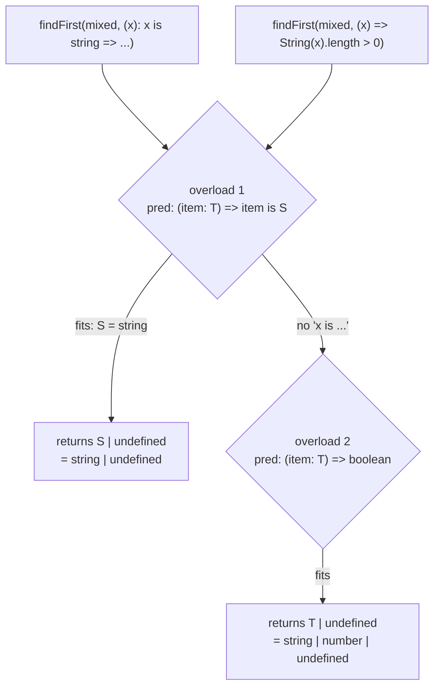
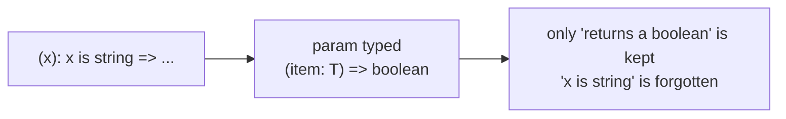

# 07 — Overloads that react to a type guard

Demo: `npm run playground cp__guard-overload`

Prompted by checkpoint 7b's `partition`. This uses a different function,
`findFirst`, so nothing is spoiled. Overload basics are in
`04-functions/LESSON.md` → "Overloads: one function, several contracts"
and `playground/04-functions/ex04__overloads.md`.

**The idea:** an overload list is a menu of signatures. TypeScript reads
the caller's arguments and picks the **first** one that fits. Here the
deciding argument is the predicate: is it a type guard or not?

*Caption: the guard call stops at overload 1 and gets the narrow type. The
plain call falls through to overload 2 and keeps the wide type.*

*Caption: without overload 1, a guard still fits, because it returns a
boolean. But the parameter type has nowhere to store `S`, so the narrowing
is lost.*

## Three signatures, three jobs

| Line | Who sees it | Job |
| --- | --- | --- |
| Overload 1: `pred: (item: T) => item is S` → `S \| undefined` | callers | catches type-guard calls; `S` is read from `x is S` |
| Overload 2: `pred: (item: T) => boolean` → `T \| undefined` | callers | catches every other predicate |
| Implementation (has a body `{ }`) | only the body | wide enough to serve both; never matched against calls |

## Gotchas

- **Order matters.** Overload 2 also accepts a guard. Put it first and it
  catches every call, so overload 1 is never reached.
- **`S extends T`** makes sure the guard narrows *within* `T`. A guard for
  some type unrelated to the items makes no sense.
- **The body can't use `S`.** Inside, only the implementation signature
  exists, so the body works with plain `T`.
- An overload line ends with `;` and has **no body**. Only the last
  signature has `{ ... }`.
