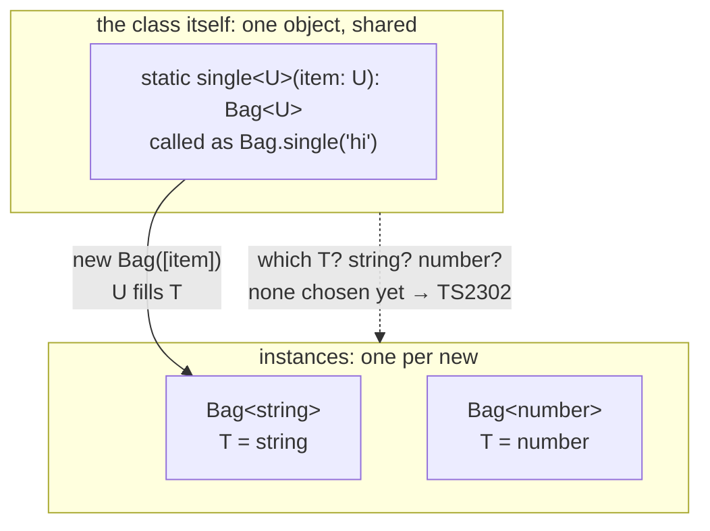
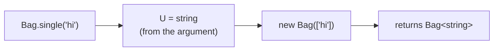

# 07 — Static factories on a generic class

Demo: `npm run playground cp__static-factory`

Prompted by checkpoint 7b's `Collection.of`. This uses a different class,
`Bag.single`, so nothing is spoiled. Background: `06-classes` statics, and
`playground/06-classes/lesson__generic-method-map.md` (class `T` vs method `U`).

**The idea:** a class has two "floors". Instances live on one. The class
itself, with its `static` members, lives on the other. `T` is chosen on
the instance floor, so a static method has no `T` to use.

*Caption: each instance has its own `T`. The class itself has many
instances under it, so there's no single `T` it could use. A static
method declares its own `U` and passes it to the instance it creates.*

*Caption: a static factory is a constructor call wrapped in a nicer
shape. Its type parameter is inferred from its own arguments, like any
generic function.*

## Constructor vs static factory

| | `new Bag(['hi'])` | `Bag.single('hi')` | `Array.of(1, 2, 3)` (built-in) |
| --- | --- | --- | --- |
| Called on | — (`new`) | the class | the class |
| Type parameter | class `T` | its own `U` | its own `T` |
| Returns | `Bag<string>` | `Bag<string>` | `number[]` |
| Why have it | the basic way | a different, nicer argument shape | same: `Array.of(7)` vs the odd `new Array(7)` |

## Gotchas

- **TS2302:** `static broken(item: T)` gives `Static members cannot
  reference class type parameters.` Declare the method's own `<U>`.
- **Return the class, not the item.** A factory returns `Bag<U>`, not `U`.
- **Inside a static method you make an instance with `new Bag(...)`**.
  `typeof Bag` in a value position is JavaScript's runtime `typeof`, and
  gives the string `"function"`.
- Statics are not on instances: `'single' in viaNew` is `false`.
