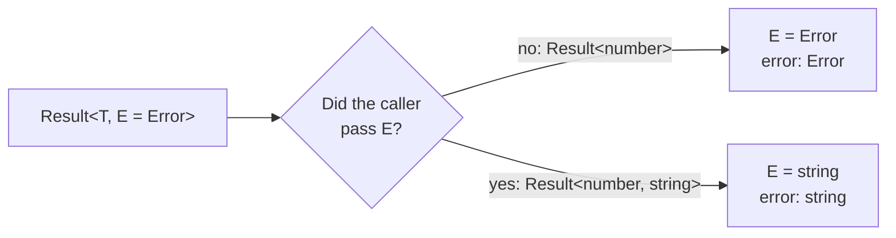
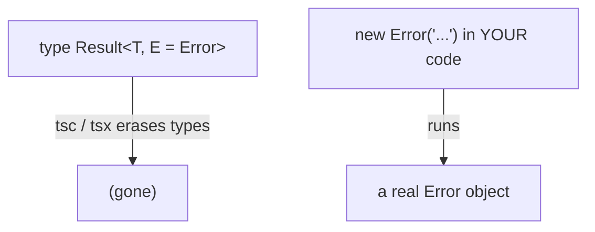

# 07 — Default type parameters: `Result<T, E = Error>`

Demo: `npm run playground ex04__default-type-param`

This came up in ex04. The question was: if `E` defaults to `Error` but
`safeDivide` returns `Result<number, string>`, is the `Error` default
wasted?

No. A default type parameter works like a default function parameter.
It is a **fallback** for when the caller leaves `E` out. When the caller
passes `E`, the default is ignored.



*Caption: the default only fills in a blank. If the caller passes `E`,
the caller's choice wins.*

## Same idea, two worlds

```ts
// Value world: default function parameter
function greet(name: string = 'friend'): string {
  return `hi ${name}`
}
greet() // name = 'friend'
greet('Ann') // name = 'Ann'

// Type world: default type parameter
type Result<T, E = Error> = { ok: true; value: T } | { ok: false; error: E }
type A = Result<number> // E = Error
type B = Result<number, string> // E = string
```

## What each spelling means

| You write | `E` becomes | Failure branch must return | Caller can use |
| --- | --- | --- | --- |
| `Result<number>` | `Error` (default) | `{ ok: false, error: new Error('…') }` | `.message`, `.name`, `.stack` |
| `Result<number, string>` | `string` | `{ ok: false, error: 'division by zero' }` | string methods |
| `Result<string, 404 \| 500>` | `404 \| 500` | `{ ok: false, error: 404 }` | `switch` on the code |

## Nothing is "wasted" at runtime



*Caption: `E = Error` never builds an object. Only a `new Error(...)` that
you write creates one. The default is a compile-time rule.*

## Gotchas

- Returning a string when `E` defaulted to `Error` fails with
  `TS2322: Type 'string' is not assignable to type 'Error'`. Read the
  signature: if it says `Result<number>`, you owe an `Error`.
- Code that **consumes** a `Result` (like `unwrapOr`) should take `E` as
  its own type parameter. If it hard-codes `string`, it rejects every
  `Result<…>` that uses the `Error` default.
- Defaults must come **last**: `type R<E = Error, T>` is error TS2706
  ("Required type parameters may not follow optional type parameters").
