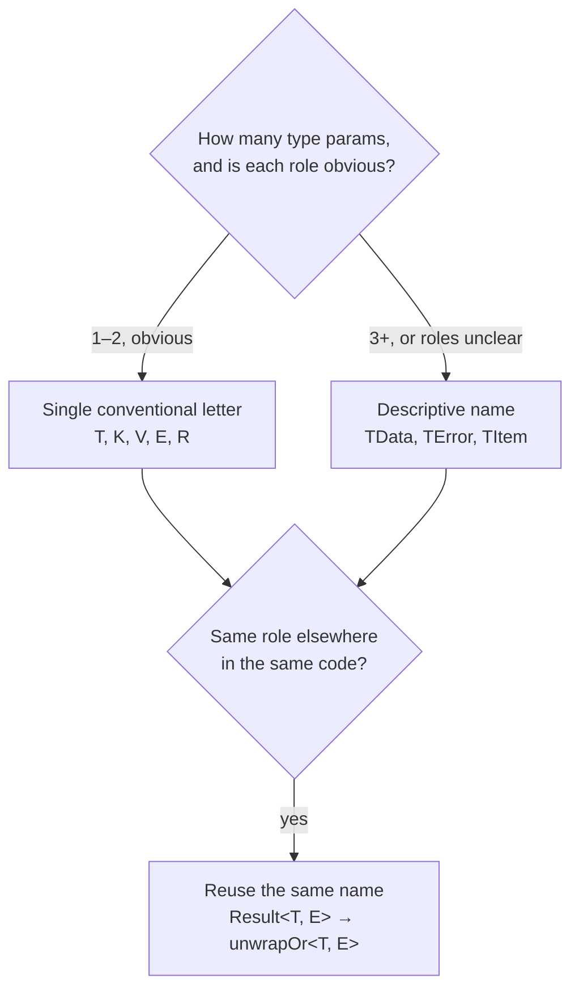

# 07 — Naming type parameters: `T`, `K`, `V`, `R`, `E`, …

Demo: `npm run playground ex04__type-param-naming`

This came up after ex04 (`unwrapOr<V, E>` vs `<T, E>`).

A type parameter's name has no effect on the compiler. It's for the
reader. The letters are a shared vocabulary: `K` tells a reader "this is
a key" before they read the constraint.

*Caption: use a short letter when the role is obvious and a descriptive
name when it isn't. Either way, the same role keeps the same name.*

## The conventional letters

| Letter | Usually means | Where you'll see it |
| --- | --- | --- |
| `T` | "the" type, the main one | `Array<T>`, `Promise<T>`, `Partial<T>` |
| `U` | a second, independent type (the letter after `T`) | `Array<T>.map<U>(fn: (x: T) => U): U[]` |
| `K` | a key | `Pick<T, K extends keyof T>`, `Map<K, V>`, `Record<K, T>` |
| `V` | a value (paired with `K`) | `Map<K, V>` |
| `E` | an error, or an element in some libraries | `Result<T, E>` (ex04) |
| `R` | a return type or result | `ReturnType<T>` = `... infer R ? R : any` |
| `A` / `P` | an arguments or parameters tuple | `Parameters<T>` = `... infer P ...`, `(...args: A) => R` |
| `S` | state | React's `useState<S>` |
| `P` | props (React) | `ComponentType
` |

All the built-in examples above are in `node_modules/typescript/lib/lib.es5.d.ts`
and `lib.es2015.collection.d.ts`. Hover a type in VS Code and choose
"Go to Definition" to see them.

## Single letter vs descriptive name

| Situation | Prefer | Example |
| --- | --- | --- |
| 1–2 params, role clear from position or constraint | single letter | `identity<T>`, `pluck<T, K extends keyof T>` |
| 3+ params | `T`-prefixed descriptive | TanStack Query: `useQuery<TQueryFnData, TError, TData, TQueryKey>` |
| role not obvious (two "main" types) | descriptive | `convert<TInput, TOutput>` instead of `convert<T, U>` |
| long body, the letter is far from its declaration | descriptive | `TItem` in a 40-line reducer |

The `T` prefix (`TData`, not `Data`) is a common convention. It marks a
type parameter, not a real type, so the name can't clash with an
interface called `Data`.

## Gotchas

- **Shadowing.** `function describe<Error>(e: Error)` declares a *new*
  type named `Error`. Inside, it hides the global `Error`, so `e.message`
  fails: `TS2339: Property 'message' does not exist on type 'Error'`.
  Never name a type parameter after a real type. Use `E` or `TError`.
- **Used once means unnecessary.** A type parameter should appear at
  least twice in the signature, because its job is to *link* two places.
  `lengthOfBad<T extends string>(s: T): number` links nothing, so plain
  `s: string` is equivalent. typescript-eslint's
  `no-unnecessary-type-parameters` rule flags this. It needs type-aware
  linting, which this course's ESLint config doesn't turn on.
- **Consistency beats the "right" letter.** `<V, E>` in `unwrapOr` compiled
  fine. But `Result` calls the value `T`, so `T` in `unwrapOr` lets the
  reader see the link without thinking.
- **`E` is ambiguous** (error or element). If both meanings could appear
  in the same file, write `TError` / `TElement`.
