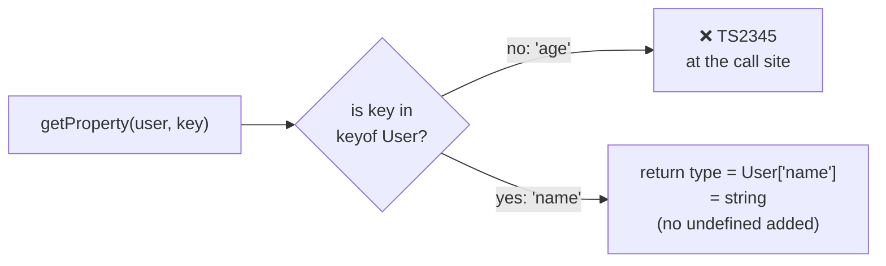
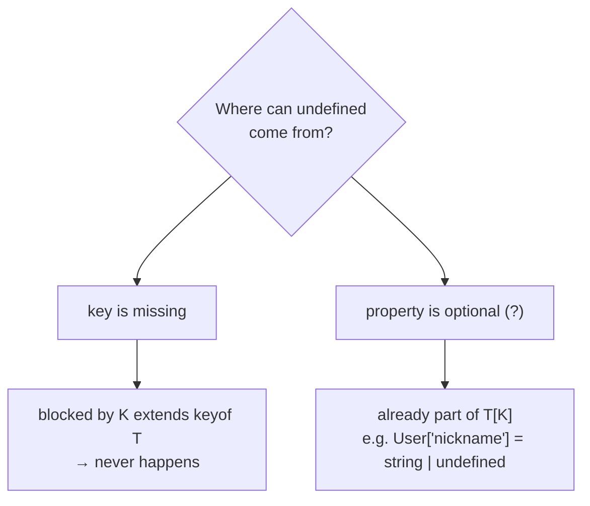

# 07 — Why `T[K]` needs no `| undefined`

Demo: `npm run playground ex06__keyof-no-undefined`

This came up in ex06. The question was: `getProperty` returns `obj[key]`.
Why isn't the return type `T[K] | undefined`?

```ts
function getProperty<T, K extends keyof T>(obj: T, key: K): T[K] {
  return obj[key]
}
```

`undefined` comes from a lookup only when the key might be **missing**.
The constraint `K extends keyof T` rules that out. A wrong key never
gets into the function.

## Where the check happens



*Caption: the compiler checks the key at the call site. Inside the
function the key is known to exist, so the return type needs no
fallback.*

## Where `undefined` can still come from



*Caption: `T[K]` copies the property's declared type exactly. If the
property is optional, `undefined` is already part of that type.*

## What each call returns

Checked with the course tsconfig (`strict` + `noUncheckedIndexedAccess`).

| Call | Return type | Where the type comes from |
| --- | --- | --- |
| `getProperty(user, 'name')` | `string` | required property |
| `getProperty(user, 'nickname')` | `string \| undefined` | the `?` on `nickname` |
| `getProperty(user, 'age')` | ❌ TS2345 | `'age'` is not in `keyof User` |
| `getProperty(scores, 'bob')` with `Record<string, number>` | `number` ⚠️ | `keyof` is all of `string` |
| `scores['bob']` (direct lookup) | `number \| undefined` | `noUncheckedIndexedAccess` |

## Gotchas

- Don't write `T[K] | undefined` yourself. On a required property it
  makes every caller handle a case that can't happen.
- **Index signatures:** for `Record<string, number>`, `keyof` is `string`,
  so any key passes the constraint. That doesn't mean the key exists.
  The generic `T[K]` also loses the `undefined` that
  `noUncheckedIndexedAccess` adds to a direct `scores['bob']`. The
  demo prints `undefined` for a value typed `number`.
- So `getProperty` is safest on objects with a **fixed** set of keys
  (interfaces, object literals). It's less safe on dictionaries.
- See `lesson__keyof-lookup.md` for how `keyof`, `K` and `T[K]` fit
  together.
