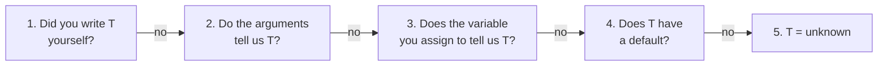
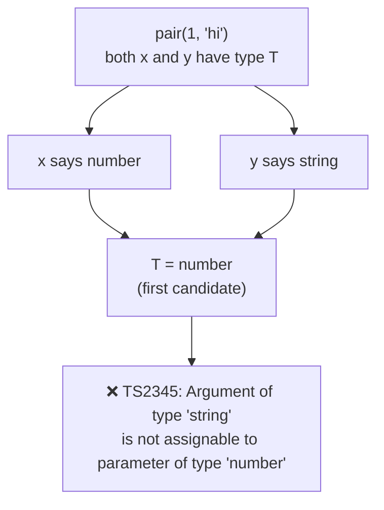

# 07 — How the compiler picks `T`

Demo: `npm run playground lesson__how-T-is-picked`

This explains the "How the compiler picks T" chart at the top of
`07-generics/LESSON.md`.

When you call a generic function without writing `<...>`, TypeScript
has to decide what `T` is. It checks a few places in a fixed order and
stops at the first one that answers.



*Caption: each "yes" stops the search. You write it, then arguments,
then the annotated target, then the default, and finally `unknown`.*

## The functions used below

```ts
function firstItem<T>(items: readonly T[]): T | undefined {
  return items[0]
}

function pair<T>(x: T, y: T): T[] {
  return [x, y]
}

function parseAs<T>(json: string): T {
  return JSON.parse(json)
}

function parseOr<T = string>(json: string): T {
  return JSON.parse(json)
}

const words = ['hi', 'yo']
```

## Step by step

1. **You wrote it.** `firstItem<string>([])` makes `T` exactly `string`.
   Nothing is inferred.
2. **The arguments.** This is the usual case. Each argument is lined up
   against its parameter. `string[]` vs `readonly T[]` gives `T = string`.
3. **The annotated target.** `parseAs` takes only `json: string`, so no
   argument mentions `T`. In `const f: number = parseAs('42')`,
   the `: number` gives `T = number`.
4. **The default.** `parseOr` declares `T = string`. In
   `const g = parseOr('"x"')` there is no other clue, so `T = string`.
5. **Nothing.** `const h = parseAs('42')` gives `T = unknown`. That's
   the safest type. You must narrow it before you can use it.

## Several candidates: first wins, no silent union



*Caption: when two arguments disagree, TypeScript does not quietly make
a union. It picks the first candidate and reports the other argument.*

You only get a union when **one** value already holds both types, like
`firstItem([1, 'a'])`. That array literal is `(string | number)[]`.
You can also ask for a union yourself: `pair<number | string>(1, 'hi')`.

## Cheat sheet

| Call | Where `T` came from | `T` |
| --- | --- | --- |
| `firstItem<string>([])` | you wrote it | `string` |
| `firstItem(words)` | argument | `string` |
| `pair('hi', 'yo')` | arguments agree | `string` |
| `pair(1, 'hi')` | first argument wins | `number`, then ❌ error |
| `firstItem([1, 'a'])` | one mixed array argument | `string \| number` |
| `const f: number = parseAs('42')` | annotated variable | `number` |
| `parseOr('"x"')` | default | `string` |
| `parseAs('42')` | nothing | `unknown` |

## The last box: substitution

Every path ends the same way. The chosen `T` replaces every `T` in the
signature. For `firstItem(words)`, `T = string`, so the compiler checks
the call as if you had written this function:

```ts
// What you wrote:
function firstItem<T>(items: readonly T[]): T | undefined {
  return items[0]
}

// How the compiler sees it for this call, with T = string:
function firstItemOfStrings(items: readonly string[]): string | undefined {
  return items[0]
}
```

That's why the result is `string | undefined`, not `any`.

## Gotchas

- An explicit `<...>` turns inference **off** for that call. Write it
  only when inference has nothing to work with or picks the wrong type.
- Step 3 only works with an **annotation**. `const h = parseAs('42')`
  has nothing to read from, so `T` becomes `unknown`.
- `parseAs`'s return type `T` is a lie the caller tells. `JSON.parse` doesn't
  check anything at runtime. `T` here is only a promise.
