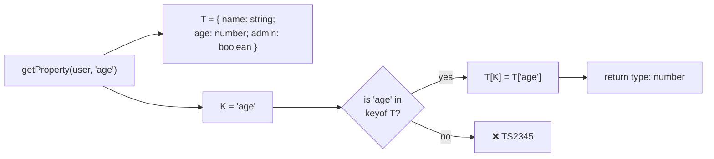
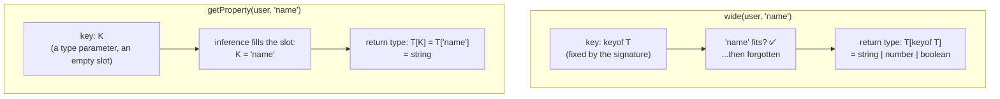

# 07 — `K extends keyof T` and `T[K]`: a typed property lookup

Demo: `npm run playground lesson__keyof-lookup`

This is from the "Minimal syntax" block of `07-generics/LESSON.md`:

```ts
function getProperty<T, K extends keyof T>(obj: T, key: K): T[K] {
  return obj[key]
}
```

The signature combines three ideas.

| Piece | Reads as | For `user = { name: 'Ada', age: 36, admin: true }` |
| --- | --- | --- |
| `keyof T` | "the union of T's key names" | `'name' \| 'age' \| 'admin'` |
| `K extends keyof T` | "K must be one of those keys" | `'email'` is rejected |
| `T[K]` | "the value type stored at key K" | `T['age']` is `number` |

## How one call is checked



*Caption: the arguments set T and K, the constraint checks K, and
then T[K] gives the exact return type.*

`K` is inferred as the **literal** `'age'`, not `string`. That's
because it is constrained to `keyof T`, which is a union of literals.

## Why a separate `K`?

You pass `'name'` to both versions below. The question is whether the
signature has a **slot** that records it.

```ts
const user = { name: 'Ada', age: 36, admin: true }

function wide<T>(obj: T, key: keyof T) {
  return obj[key]
}
const w = wide(user, 'name')         // type: string | number | boolean

function getProperty<T, K extends keyof T>(obj: T, key: K): T[K] {
  return obj[key]
}
const g = getProperty(user, 'name')  // type: string
```

Reminder: `: T[K]` after the `)` is the **return type**, the type of
what comes out. `return obj[key]` in the body is the **value** that comes out.

In `wide`, the type of `key` is fixed by the signature as `keyof T`,
which is `'name' | 'age' | 'admin'`. TypeScript checks that `'name'`
fits, then forgets it. The return type is `T[keyof T]`, the value at
*some* key, so you get all three value types.

In `getProperty`, `K` is a **type parameter**, an empty slot. Inference
fills it from the argument, just as it fills `T`
(see `lesson__how-T-is-picked.md`, step 2): argument `'name'` vs
parameter `K` gives `K = 'name'`. So `T[K]` is `T['name']`, which is `string`.



*Caption: both versions check the key. Only the one with a type
parameter K remembers WHICH key it was.*

Same idea, simpler:

```ts
function plain(x: number) {
  return x
}
const p = plain(5)   // type: number (checked, then forgotten)

function echo<X>(x: X) {
  return x
}
const e = echo(5)    // type: 5 (captured)
```

`key: keyof T` is like `plain`. `key: K` is like `echo`.

| Part of `K extends keyof T` | Job |
| --- | --- |
| `K` | the slot that **remembers** which key you passed |
| `extends keyof T` | the rule that **checks** it's a real key |

## Three versions compared

`wide` and `getProperty` are defined above. Here is the third version,
which has no generics at all:

```ts
function getLoose(obj: Record<string, unknown>, key: string): unknown {
  return obj[key]
}
const l = getLoose(user, 'email')    // no error, type: unknown
```

| Function | `key` parameter type | Rejects `'email'`? | Return type for `'name'` |
| --- | --- | --- | --- |
| `getLoose` | `string` | no | `unknown` |
| `wide` | `keyof T` | yes | `string \| number \| boolean` |
| `getProperty` | `K` (with `K extends keyof T`) | yes | `string` ✅ |

## Gotchas

- `extends` in `<K extends keyof T>` means "must fit inside", not class
  inheritance. It's the same constraint idea as `Party<T extends Combatant>`
  from module 06.
- `keyof` works on **types**. On a value, write `keyof typeof user`.
- The real error for a bad key names the full allowed union:
  `Argument of type '"email"' is not assignable to parameter of type '"name" | "age" | "admin"'`.
- Built-in helpers use the same pattern. `Pick<T, K extends keyof T>`
  is one of them.
