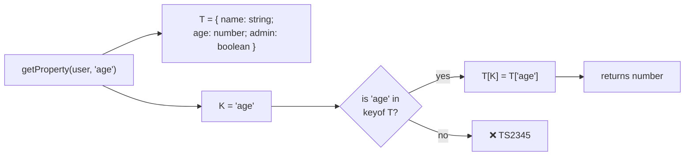
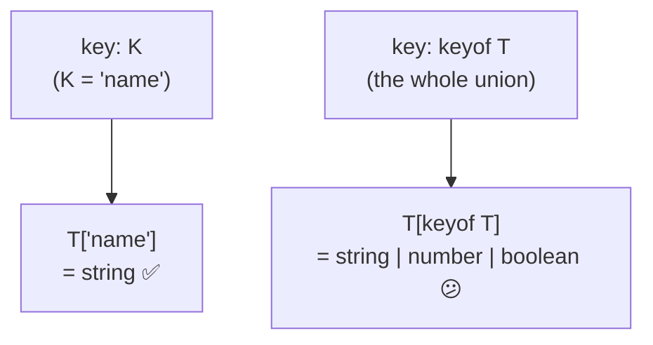

# 07 — `K extends keyof T` and `T[K]`: a typed property lookup

Demo: `npm run playground lesson__keyof-lookup`

This is from the "Minimal syntax" block of `07-generics/LESSON.md`:

```ts
function getProperty<T, K extends keyof T>(obj: T, key: K): T[K] {
  return obj[key]
}
```

The signature combines three ideas.

| Piece | Reads as | For `user = { name: 'Ada', age: 36, admin: true }` |
| --- | --- | --- |
| `keyof T` | "the union of T's key names" | `'name' \| 'age' \| 'admin'` |
| `K extends keyof T` | "K must be one of those keys" | `'email'` is rejected |
| `T[K]` | "the value type stored at key K" | `T['age']` is `number` |

## How one call is checked



*Caption: the arguments set T and K, the constraint checks K, and
then T[K] gives the exact return type.*

`K` is inferred as the **literal** `'age'`, not `string`. That's
because it is constrained to `keyof T`, which is a union of literals.

## Why a separate `K`?



*Caption: a separate K remembers WHICH key you passed. Without it,
TypeScript only knows "some key", so the result is every value type.*

| Signature | Rejects `'email'`? | Return type for `'name'` |
| --- | --- | --- |
| `(obj: Record<string, unknown>, key: string)` | no | `unknown` |
| `<T>(obj: T, key: keyof T)` | yes | `string \| number \| boolean` |
| `<T, K extends keyof T>(obj: T, key: K): T[K]` | yes | `string` ✅ |

## Gotchas

- `extends` in `<K extends keyof T>` means "must fit inside", not class
  inheritance. It's the same constraint idea as `Party<T extends Combatant>`
  from module 06.
- `keyof` works on **types**. On a value, write `keyof typeof user`.
- The real error for a bad key names the full allowed union:
  `Argument of type '"email"' is not assignable to parameter of type '"name" | "age" | "admin"'`.
- Built-in helpers use the same pattern. `Pick<T, K extends keyof T>`
  is one of them.
