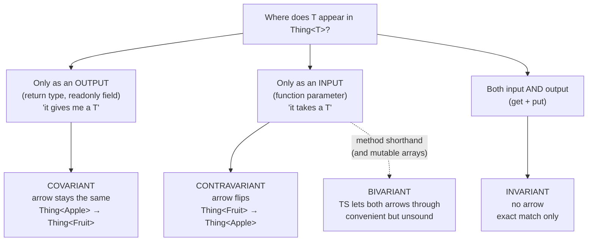
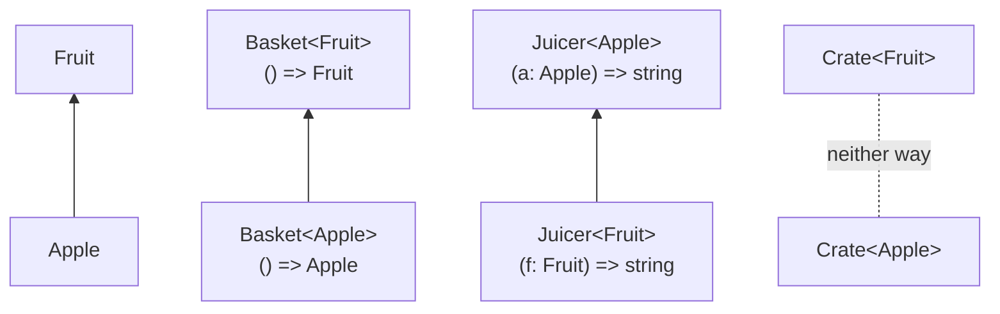

# Covariance vs contravariance vs bivariance

Demo: `npm run playground lesson__variance`

This explains the "Variance" sections of `07-generics/LESSON.md` with a
fresh example: `Apple` is a `Fruit` (it has every Fruit field, plus `crunch`).

Variance answers one question:

> `Apple` fits where `Fruit` is expected. Does **`Thing<Apple>`** fit where
> **`Thing<Fruit>`** is expected? Or the other way round? Or both? Or neither?

The answer depends on **what `Thing` does with its `T`**.

## The one question to ask: does it give or take?

*Caption: outputs keep the arrow, inputs flip it, read-and-write blocks
it. Bivariance is TypeScript choosing to be loose in a few spots on purpose.*

## The arrows side by side

*Caption: an arrow means "fits where the other is expected". The basket arrow
points the same way as Apple → Fruit. The juicer arrow points backwards.*

## Why the juicer flips (the part that confuses everyone)

Think about **who calls the function**. Someone holding a `Juicer<Fruit>`
believes they may feed it **any fruit**, a banana included.

- Give them an **any-fruit juicer** where they asked for an apple juicer?
  Fine. It handles apples, and more besides.
- Give them an **apple-only juicer** where they asked for an any-fruit juicer?
  They feed it a banana. It reads `banana.crunch.toFixed()`. 💥

So the juicer that **accepts more** is the one that substitutes. That is the
opposite of the basket, where the one that **gives something more specific** substitutes.

## Cheat sheet

| Term | Arrow | `T` appears as | Example | Safe? |
| --- | --- | --- | --- | --- |
| **Covariant** | same: `X<Apple>` → `X<Fruit>` | output | `() => T`, `readonly T[]`, `Promise<T>` | ✅ |
| **Contravariant** | flipped: `X<Fruit>` → `X<Apple>` | input | `(item: T) => void` (property syntax) | ✅ |
| **Bivariant** | both directions accepted | input, but checked loosely | `juice(f: T): string` (method syntax), mutable `T[]` | ❌ holes |
| **Invariant** | neither direction | input **and** output | `{ get: () => T; put: (item: T) => void }` | ✅ |

## Memory tricks

- **Co** = "**co**mes out" = goes **with** the arrow.
- **Contra** = "goes in" = goes **against** the arrow.
- **Bi** = "two" = both arrows allowed (TS being lenient, not correct).
- **In** = "**in**flexible" = invariant, exact type only.

## Gotchas

- Bivariance is a **deliberate compromise**, not a rule of logic. The demo's
  section 3 compiles, then crashes at runtime with the same error as the
  rejected section 2.
- Prefer **property syntax** (`juice: (f: Fruit) => string`) in your own types.
  It gets the strict contravariant check. Method syntax (`juice(f: Fruit): string`) does not.
- A mutable array has `push(item: T)`, an input. By the cheat sheet it
  should be invariant. TypeScript checks it bivariantly instead. `readonly T[]`
  removes `push`, so only outputs remain and it becomes honestly covariant.
- One function type can be both at once: in `(f: Fruit) => Apple` the
  parameter is contravariant and the return type is covariant.
